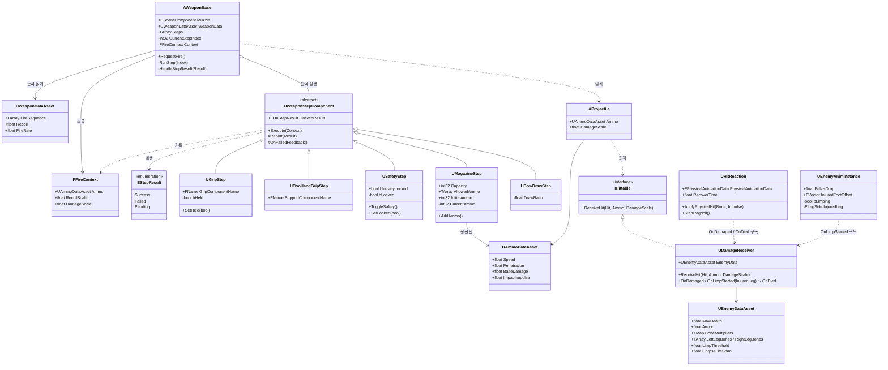

# 젠틀몬스터 VR 포트폴리오 계획서

> 대상 공고: [GENTLE MONSTER] Unreal Engine 게임 개발자 (뉴프로젝트 파트, VR 슈팅 어드벤처)
> 작성일: 2026-10-28 / 갱신: 2026-10-28 (Phase 1 설계 완료: 노출 범위, FFireContext, 클래스 구조도 반영)

---

## 1. 목표

### 1.1 무엇을 증명해야 하는가

- 19년 클라이언트 경력과 전투 시스템 전문성으로 "게임을 잘 만드는가"는 의심받을 가능성이 낮다.
- 공고 기준으로 가장 먼저 의심받을 지점은 **UE5 C++/Blueprint 실무 능숙도**다.
- "언리얼로 만들었다"는 사실만으로는 부족하다. **언리얼을 언리얼답게 쓴다**는 것을 보여줘야 한다.

### 1.2 공고와의 연결

| 공고 담당업무 | 포트폴리오에서 증명할 요소 |
|---|---|
| 적, 슈팅, 컴뱃 시스템 개발 | 컴포넌트 조합형 무기 시스템, 마네킹 적과의 전투 구간 |
| 물리 시뮬레이션과 물체 간 상호작용 | VR 손으로 무기를 집고 조작, 물리 기반 피격 반응 |
| 실험적 기능의 R&D 및 프로토타이핑 | C++ 수정 없이 컴포넌트 조합과 데이터만으로 새 무기 제작 |
| 외부 개발사 검수 및 관리 | 기획/외주가 만질 수 있는 영역과 보호되는 코어의 경계 설계 |

---

## 2. 설계 원칙

### 2.1 유니티의 기준을 언리얼 도구로 표현

| 원칙 | 유니티 | 언리얼 |
|---|---|---|
| 코어 보호, 노출 범위 통제 | 인스펙터 노출, 접근 제한 | C++ + `UPROPERTY(EditDefaultsOnly)`, `BlueprintReadOnly` 등 지정자 |
| 변수형 데이터 분리 | ScriptableObject | `UDataAsset` / `UPrimaryDataAsset` |
| 대량 표 형태 데이터 | SO 목록, CSV | `DataTable` (C++ 구조체 기반, CSV 임포트) |
| 조립과 튜닝 | 프리팹 + 컴포넌트 | 블루프린트 서브클래스 + 데이터 에셋 |

### 2.2 역할 분리

- **C++**: 코어와 규칙을 소유하고, 무엇을 열어줄지 선언으로 결정한다.
- **Blueprint / Data Asset**: 기획자와 외주사가 열린 부분만 조립하고 튜닝한다.
- **상수 vs 변수**: 고정 규칙은 보호한다. 반동, 연사 속도, 체력, 무게처럼 손맛을 좌우하는 값은 빌드 없이 조정 가능해야 한다.

---

## 3. 게임 콘셉트

**여러 총기를 직접 집어서 쏘는 VR 슈팅, 마네킹 적과의 짧은 전투 구간**

- "여러 총기" → 데이터 기반 설계 증명
- "직접 집어서" → 물리 상호작용 증명
- 무기는 수치만 다른 것이 아니라 **다루는 방식 자체가 달라야 한다**
  - 권총: 한 손, 외장 탄창 교체
  - 소총: 권총 구성 + 두 손 파지 (+ 안전장치)
  - 샷건: 두 손, 내장 탄창, 펌프 조작
  - 활: 탄창 없음, 시위를 당긴 거리만큼 위력 변화

---

## 4. 무기 시스템 구조

### 4.1 코어

- **발사 원점과 방향** (총열 위치 → "발사 원점"으로 일반화, 활까지 포함)
- 무기 데이터에 정의된 **발사 흐름 순서**를 읽고 컴포넌트를 차례로 실행한다.
- 컴포넌트의 구체 타입을 알지 못한다.

### 4.2 컴포넌트

- 탄창 유무, 탄창 방식, 한 손/두 손 파지는 **플래그가 아니라 컴포넌트의 존재 여부**로 표현한다 (ECS 발상).
- 예시: 탄창 컴포넌트(탄창 크기, 허용 탄 종류), 파지 컴포넌트(손 위치), 안전장치 컴포넌트, 시위 당김 컴포넌트, 충전 컴포넌트 등
- **새 기능은 새 컴포넌트로 추가한다.** 특정 무기에만 필요한 단계(예: 소총의 안전장치)도 기존 컴포넌트를 수정하지 않고 별도 컴포넌트로 만든다.
- 각 컴포넌트는 **"다음 단계"를 모른다.** 자기 작업만 수행하고 결과를 발행한다.

### 4.3 결정: 진행 순서 정보의 위치 ✅

- **흐름 순서는 무기 단위로, 무기 데이터에 한곳에 모은다.**
- 이유
  - 같은 컴포넌트를 여러 무기가 공유하므로, 순서는 컴포넌트가 아니라 **무기의 속성**이다.
  - 컴포넌트가 "다음"을 알면 순서 정보가 여러 컴포넌트에 흩어지고, 공유 컴포넌트 수정 시 다른 무기에 영향을 준다.
  - 한곳에 모여 있어야 기획자가 전체 흐름을 확인하고 바꾸기 쉽다.
  - PDF에서도 한 줄로 보여줄 수 있다. 예: `소총 = 파지 → 안전장치 → 탄창 → 발사`

### 4.4 결정: 코어와 컴포넌트의 계약 ✅

- 모든 단계 컴포넌트는 **공통 인터페이스**를 구현한다.
- 실행되면 다음 세 가지 중 하나를 **발행**하고, 코어는 **델리게이트로 구독**한다.

| 상태 | 의미 | 코어의 처리 | 예시 |
|---|---|---|---|
| **Success** | 이 단계 완료 | 다음 단계로 진행 | 파지 확인됨, 탄 있음 |
| **Failed** | 게임상 정상적인 거절 | 흐름 중단 | 안전장치 잠김, 탄 없음, 손 없음, 맞지 않는 탄 장전 |
| **Pending** | 완료 보고 대기 | 보고가 올 때까지 대기 | 활 시위 당기는 중 |

- "Error"는 버그와 예외 상황용으로 남겨두고, 게임 규칙상의 거절은 **Failed**로 구분한다.
- **구체적인 피드백은 상태를 발행한 컴포넌트가 책임진다.** (예: 탄창 컴포넌트가 Failed 발행과 함께 빈 격발음 재생) 코어는 끝까지 개별 컴포넌트의 사정을 모른다.
- **실패 피드백 호출은 부모가 보장한다.** ✅ `UWeaponStepComponent::Report`(비가상)가 `Failed`일 때 `OnFailedFeedback`(`BlueprintImplementableEvent`)을 호출한 뒤 결과를 발행한다. 자식은 `Report(Failed)`만 부르면 되므로 피드백 누락이 구조적으로 불가능하다. 피드백 내용은 각 단계 블루프린트가 이벤트를 구현해 정하고, 피드백이 필요 없는 단계는 구현하지 않는다. 한 단계 안에서 실패 이유별로 다른 피드백이 필요해지면 `OnFailedFeedback`에 이유를 넘기는 방향으로 확장한다.
- 비동기 단계(Pending)가 있으므로 즉시 반환형 함수 호출보다 발행/구독 방식이 적합하다.
- 공통 계약은 `UInterface`가 아니라 **추상 컴포넌트 클래스 `UWeaponStepComponent`** 로 구현한다. 모든 단계가 액터 컴포넌트이고, 델리게이트와 공통 보고 함수를 부모에 한 번만 구현하면 되기 때문이다.

### 4.5 결정: FFireContext 규칙 ✅

- 코어가 단계 컴포넌트의 구체 타입을 모른 채 발사에 필요한 정보를 얻기 위한 **공용 보고서 구조체**. 각 단계가 흐름 중에 기록하고, 코어는 마지막에 읽어 발사한다.
- 단계 컴포넌트와 코어가 **공유해야 하는 정보만** 담는다. 단계끼리만 쓰는 정보나 단계 내부 상태는 넣지 않는다.
- 칸 이름은 **코어가 쓰는 의미**로 짓는다. (`DrawRatio` ✗ → `DamageScale` ✓) 그래야 새 무기 유형이 생겨도 구조체가 늘어나지 않는다.

| 칸 | 의미 | 기록하는 단계 예시 |
|---|---|---|
| `Ammo` | 발사할 탄 데이터 | 탄창 |
| `RecoilScale` | 반동 배율 | 두 손 파지 |
| `DamageScale` | 피해 배율 | 활 시위 당김, 충전식 무기 |

### 4.6 클래스 구조도 (초안)

**구조도에서 확인할 점**
- `AWeaponBase`는 추상 타입 `UWeaponStepComponent`만 알고, 구체 단계 클래스와 직접 연결되지 않는다. 새 단계는 상속선만 늘어난다.
- 무기 시스템과 적 시스템은 `AProjectile`이 탄 데이터를 전달하는 지점에서만 만난다. 피해 계산은 `UDamageReceiver`에서 처리한다.
  - **만나는 지점은 인터페이스 `IHittable`이다.** ✅ 무기 쪽(`Weapon/Hittable.h`)이 정의하고 투사체는 이것만 안다. 의존 방향은 적 → 무기 한쪽뿐이다(6.5).
- 메시 교체를 위해 발사 원점, 파지 위치, 탄창 결합부는 이름이 정해진 소켓 또는 Scene Component로 두고, 컴포넌트는 그 이름으로만 위치를 찾는다.
  - **발사 원점 `Muzzle`은 코어(`AWeaponBase` 생성자)가 만든다.** ✅ 모든 무기에 빠짐없이 있고, 블루프린트는 위치만 옮긴다. 투사체는 `Muzzle`의 앞 방향(X)으로 나간다.
  - **무기 루트는 코어가 만드는 박스 충돌체 `Body`다.** ✅ 메시, 잡기 컴포넌트, `Muzzle`은 모두 그 아래에 둔다. 루트가 빈 Scene Component면 템플릿 잡기가 루트 아래의 메시만 손에 붙여 `Muzzle`이 제자리에 남는다. 충돌체 루트는 메시 종류(스태틱/스켈레탈)와 무관하고, 놓을 때 물리도 루트에 걸린다.

### 4.7 결정: 파지와 잡기 시스템 ✅

- **잡기 자체(손 근처 탐색, 컨트롤러에 붙이기, 햅틱, 물리)는 잡기 시스템이 맡는다.** 파지 단계는 잡혔다/놓였다는 결과만 듣고, 발사 흐름에서 파지 상태를 검사한다. 발사 단계와 상호작용 처리를 한 클래스에 섞지 않는다.
- **잡기 시스템은 VR 템플릿의 `BP_GrabComponent`와 `BP_XRPawn`을 그대로 쓴다.** 손 탐색과 붙이기를 다시 만들지 않는다. C++은 블루프린트 클래스를 참조할 수 없으므로, 템플릿과의 연결은 `UGripStep`의 블루프린트 자식(`BP_GripStep`)이 맡는다.
- **파지 상태의 원본은 `UGripStep::bHeld`다.** `OnGrabbed`/`OnDropped`가 올 때 `SetHeld`(`BlueprintCallable`)로 갱신하고, `Execute`는 `bHeld`만 본다. 노출 규칙(상태값은 `VisibleInstanceOnly`, 변경은 함수로만)을 따른다.
- **`BP_GripStep`은 이름으로 자기 잡기 컴포넌트를 찾는다.** `GripComponentName`과 같은 이름의 `BP_GrabComponent`를 `BeginPlay`에서 찾아 스스로 구독한다. 무기마다 배선하지 않으며, 두 손 무기(주 손잡이 + 보조 손잡이)도 이름만 달리 설정한다. 잡기 컴포넌트가 곧 파지 위치(Scene Component)다.
- **템플릿 잡기는 액터가 아니라 잡기 컴포넌트의 부모 컴포넌트를 손에 붙인다.** 그래서 주 손잡이 잡기 컴포넌트는 루트 `Body` 바로 아래에 둔다. 보조 손잡이는 Step 5 이후 두 손 파지에서 따로 다룬다.
- **트리거 입력은 무기가 받는다.** ✅ 템플릿 권총처럼 잡힐 때 잡은 손의 입력 매핑을 켜고 놓을 때 끈다. Pawn은 고치지 않는다.
- **트리거 입력은 발사 단계가 아닌 입력 전용 컴포넌트 `UTriggerInputComponent`가 맡는다.** ✅ 단계의 `Execute`는 `RequestFire` 이후에 실행되므로, 트리거를 단계로 두면 판단할 일이 없다. 입력 컴포넌트는 `RequestFire`를 부르기만 한다. 템플릿과의 연결(어느 손인지)은 블루프린트 자식 `BP_TriggerInput`이 `GripStep`과 같은 방식(이름으로 잡기 컴포넌트를 찾아 구독)으로 한다. 반자동/자동 같은 발사 모드는 필요해질 때 따로 정한다.

### 4.8 결정: 그레이박스 권총과 발사 피드백 ✅

- **권총은 테스트 무기와 별도의 블루프린트(`BP_PistolWeapon`)와 데이터 에셋(`DA_Pistol`)으로 만든다.** 필요한 부품만 붙여 `권총 = 파지 → 탄창 → 발사`가 그대로 보이게 한다. `BP_TestWeapon`은 더미 단계 실험용으로 남긴다.
- **기준점은 `Muzzle`(코어), `Grip`(잡기 컴포넌트), `MagazineWell`(Scene Component) 세 개다.** `MagazineWell`은 자리만 두고, 위치를 쓰는 코드는 탄창 교체를 만들 때 연결한다.
- **코어는 발사할 때 `OnFired(Recoil)` 델리게이트만 발행한다.** 반동 세기는 `Recoil × RecoilScale`이다. 구체적인 발사 피드백은 이 이벤트를 구독하는 컴포넌트가 맡는다(설계 규칙 4).
- **발사 햅틱은 잡은 손을 아는 `UTriggerInputComponent`가 `OnFired`를 구독해서 준다.** 세기는 반동 세기(0~1로 제한)다. 눈에 보이는 반동(총이 튀었다 돌아오기)은 손맛 조정 단계에서 따로 다룬다.

### 4.9 결정: 안전장치 ✅

- **안전장치는 발사 단계 `USafetyStep`이다.** 잠겨 있으면 `Failed`, 풀려 있으면 `Success`. 잠김 피드백은 `OnFailedFeedback`으로 블루프린트 자식(`BP_SafetyStep`)이 정한다. 걸고 풀 때의 피드백(딸깍 소리 등)은 `OnSafetyChanged(bLocked)`(`BlueprintImplementableEvent`)로 같은 자식이 정한다.
- 잠금 상태 `bLocked`는 실행 중 상태값이고 변경은 `SetLocked`/`ToggleSafety`로만 한다. 배치 시 처음 상태는 배치별 초기값 `bInitiallyLocked`(`EditInstanceOnly`, 기본 잠김)다.
- **VR에서는 무기를 잡은 손의 A/X 버튼으로 토글한다.** 템플릿이 쓰지 않는 버튼(`OculusTouch_Right_A_Click`, `OculusTouch_Left_X_Click`)이다. 트리거처럼 잡을 때 그 손의 입력 매핑을 켜고 놓을 때 끈다. 시뮬레이터에서는 `B` 키다.
- **버튼은 단계가 아니라 입력 컴포넌트가 받는다(4.7).** 트리거와 안전장치 입력의 공통부분(잡은 손의 매핑 켜고 끄기, 버튼 바인딩, 무기 액터 입력 켜고 끄기)을 추상 부모 `UWeaponInputComponent`로 꺼내고, 자식은 버튼이 눌렸을 때 할 일만 구현한다. `UTriggerInputComponent`는 `RequestFire`, `USafetyInputComponent`는 같은 액터의 `USafetyStep::ToggleSafety`를 부른다. 무기 액터의 입력은 켜진 입력 컴포넌트가 하나도 없을 때만 끈다.
- 어느 손인지는 지금처럼 입력 컴포넌트의 블루프린트 자식(`BP_TriggerInput`, `BP_SafetyInput`)이 각자 잡기 컴포넌트를 구독해 판별한다. C++ 형제 클래스라 그래프를 물려받지 못해 복제되므로, 입력 컴포넌트가 더 늘면 `UGripStep`이 잡은 손도 발행하는 방식을 다시 검토한다.

---

## 5. 데이터 구조

### 5.1 결정: 데이터 위치 ✅

판단 기준: **"이 값은 무엇이 바뀔 때 같이 바뀌는가?"**

| 위치 | 담는 값 | 판단 근거 |
|---|---|---|
| 무기 데이터 에셋 | 발사 흐름 순서, 반동, 연사 속도 | 무기가 바뀌면 같이 바뀜 |
| 컴포넌트 속성 (무기 블루프린트 내) | 파지 위치, 탄창 크기, 허용 탄 종류 | 해당 무기의 메시와 구성에 묶여 있음 |
| 탄 데이터 에셋 | 투사체 클래스, 탄속, 관통력, 기본 피해 | 어떤 무기에 넣든 탄을 따라감 (탄을 바꾸면 투사체 모양도 바뀜 ✅) |
| 적 데이터 | 부위별 피해 배율, 방어력, 상태 변화 기준 | 맞은 대상과 부위를 따라감 |

### 5.2 피해 계산

- **최종 피해 = 탄 데이터(기본 피해, 관통력) × 적 데이터(부위 배율, 방어력)**
  - ✅ `최종 피해 = BaseDamage × 본 배율 × DamageScale × min(1, Penetration / Armor)` (방어력 0이면 계수 1)
- 두 데이터가 만나는 계산은 **피격 쪽에서** 처리한다. 무기 시스템과 적 시스템이 서로를 모른 채 동작한다.
- 맞지 않는 탄 장전(예: 권총에 소총탄)은 탄창 컴포넌트가 허용 탄 종류를 확인해 **Failed**로 처리한다.
  - 장전은 발사 흐름 밖의 동작이라 `AddAmmo`가 실제로 넣은 수를 돌려주고, 거절이면 0을 돌려준다. (Error가 아닌 규칙상 거절이라는 점은 같다)
- **탄창 하나에는 한 종류의 탄만 들어간다.** ✅ 탄창 상태는 `LoadedAmmo`(종류) + `CurrentAmmo`(수)다. 남은 탄과 다른 종류는 탄창이 비었을 때만 넣을 수 있다.
- **배치 시 초기 탄 종류는 `AllowedAmmo`의 첫 번째 항목이다.** ✅ 배치별로는 `InitialAmmo`(수)만 정하고, `BeginPlay`에서 `AddAmmo`를 거쳐 채워 같은 규칙으로 검사한다.

### 5.3 결정: 노출 범위 ✅

| 값의 종류 | 예시 | 에디터 수정 | 블루프린트 그래프 | 변경 경로 |
|---|---|---|---|---|
| 무기 종류 공통 설정값 | 반동, 연사 속도, 장탄수, 발사 흐름 순서 | `EditDefaultsOnly` (데이터 에셋/클래스에서만) | `BlueprintReadOnly` | 데이터 에셋 수정 |
| 탄 설정값 | 탄속, 관통력, 기본 피해 | 탄 데이터 에셋에서만 | `BlueprintReadOnly` | 데이터 에셋 수정 |
| 배치별 초기값 | 초기 탄 수 | `EditInstanceOnly` (+ 스폰 시 `ExposeOnSpawn`) | 노출 불필요 | 배치 또는 스폰 시점 |
| 실행 중 상태값 | 현재 탄 수, 안전장치 잠김 여부, 파지 상태 | `VisibleInstanceOnly` (디버그 확인용) | `BlueprintReadOnly` | `BlueprintCallable` 함수로만 (규칙 검사 포함) |
| 컴포넌트 피드백 | 빈 격발음, 잠김 표시 | — | `BlueprintImplementableEvent` 등 | 블루프린트가 연출을 덧붙임 |

**원칙**
- 무기 종류 전체가 같아야 하는 값은 인스턴스에서 수정할 수 없게 막는다. (프리팹 오버라이드 문제 방지)
- 시스템이 바꾸는 상태값은 읽기만 허용하고, 변경은 규칙을 강제하는 함수로만 연다. (예: `AddAmmo`가 장탄수 제한과 허용 탄 종류를 검사)
- 배치마다 달라도 되는 건 **초기값**뿐이고, 초기값과 현재값은 별도 속성으로 분리한다. C++ 생성자는 클래스 기본 객체(CDO)용이므로, 배치별 초기값은 속성으로 받아 `BeginPlay`에서 현재값으로 옮긴다.

---

## 6. 적 시스템

### 6.1 적 구성

- UE5 기본 마네킹(Manny / Quinn) 사용. 심사자가 보는 것은 외형이 아니라 시스템이다.
- 무기와 추가 캐릭터는 Fab 무료 에셋에서 선택한다.

### 6.2 반응 설계 (무기 차이를 눈에 보이게 만드는 장치)

- **탄착 부위에 따른 부분 피해**
- **관통력에 따른 피해 차이** (예: 권총은 더 많이 맞춰야 피해가 쌓임)

### 6.3 표현 방식

| 방식 | 채택 | 비고 |
|---|---|---|
| 부위별 피격 애니메이션 애디티브 | ✗ | 애니메이션 에셋 부담 |
| 물리 기반 피격 반응 | ✓ | `PhysicalAnimationComponent` 또는 맞은 본 아래만 `SetAllBodiesBelowSimulatePhysics` 후 블렌딩. 추가 애니메이션 불필요, 공고의 물리 시뮬레이션 업무와 직접 연결 |
| 상태 변화 | ✓ | 다리 피격 시 절뚝임 등, 애니메이션 블루프린트 상태 전환 |
| 부분 파괴 | ✗ | 범위에서 제외 |

### 6.4 결정: 적 데이터 ✅

- **부위 배율은 본마다 둔다.** `BoneMultipliers`(`TMap<본 이름, 배율>`)에 적고, 없는 본은 1.0이다. 키는 피직스 에셋에 바디가 있는 본 이름이다(Hit 결과에는 그 본만 들어온다). 1.0이 아닌 본만 적으면 된다.
- **방어력은 비율로 반영한다.** 관통력이 방어력 이상이면 100%, 모자라면 `관통력 / 방어력`만큼 들어간다. 피해가 0이 되지 않아 약한 탄은 "더 많이 맞춰야" 한다(6.2). 공식 계산은 `UDamageReceiver`가 한다.
- **절뚝임은 다리 누적 피해(절대값)로 판단한다.** 다리 본 목록 `LeftLegBones`·`RightLegBones`에 든 본에 들어간 최종 피해의 합이 `LimpThreshold` 이상이면 절뚝인다. 좌우 다리는 합쳐서 센다(목록을 좌우로 나눈 이유는 6.7). 방어력과 관통력이 그대로 반영되고, 체력을 바꿔도 기준은 그대로다.
- **최대 체력 `MaxHealth`도 적 데이터에 둔다.** 현재 체력은 `UDamageReceiver`의 상태값이다.

### 6.5 결정: 피격 전달과 결과 알림 ✅

- **투사체는 인터페이스 `IHittable`로 피해를 넘긴다.** 투사체가 적 클래스를 include하지 않는다. 기본 데미지 경로(`ApplyPointDamage`)는 숫자 하나만 넘겨서 관통력·방어력을 받는 쪽에서 계산하려면 적이 투사체를 캐스트해야 하므로 쓰지 않는다.
- **인터페이스는 컴포넌트(`UDamageReceiver`)가 구현한다.** 투사체는 맞은 액터에서 `FindComponentByInterface<IHittable>()`로 찾는다. 적 블루프린트는 컴포넌트를 붙이기만 하면 되고 전달 노드를 이을 필요가 없다. 컴포넌트 없는 대상(상자 등)이 생기면 투사체에 "액터가 구현했는지 먼저 보기"만 더한다.
- **`UDamageReceiver`는 결과를 델리게이트로 발행만 한다.** `OnDamaged(본, 피해, Hit)`, `OnLimpStarted`, `OnDied`. 피격 반응(`UHitReaction`), 애니메이션 상태, 사망 연출이 각자 구독한다. 무기의 `OnFired` → `UTriggerInputComponent`(햅틱)와 같은 모양이다.
- 사망한 뒤의 피격은 무시한다. 치명타가 다리에 맞아도 절뚝임 대신 사망만 발행한다.

### 6.6 결정: 물리 피격 반응 ✅

- **맞은 본 아래 바디만 물리로 돌리고 `UPhysicalAnimationComponent`로 애니메이션 자세 쪽에 당긴다.** 블렌드 가중치만 쓰면 물리 구간에서 부위가 힘 빠진 래그돌처럼 처지므로, 모터로 버티다 돌아오게 한다. 모터는 월드 기준(`bIsLocalSimulation` 끔)이라 골반을 맞으면 몸 전체가 흔들리되 쓰러지지 않는다.
  - 이를 위해 메시의 `PhysicsTransformUpdateMode`를 `ComponentTransformIsKinematic`으로 둔다(`UHitReaction`이 `BeginPlay`에서 설정). 기본값은 루트 바디(골반)가 물리로 돌면 컴포넌트가 그 바디를 따라가는데, 그러면 월드 기준 목표 자세도 함께 움직여 골반을 되돌릴 힘이 없고 반응이 끝난 뒤에도 액터가 돌아간 채 남는다.
- 블렌드 가중치는 `RecoverTime` 동안 1 → 0으로 줄이고, 끝나면 물리를 끈다. 반응 중인 부위 안쪽을 다시 맞으면 그 반응을 다시 시작하고, 바깥(조상 본)을 맞으면 안쪽 반응을 흡수한다.
- **충격량 = 탄의 `ImpactImpulse` × (최종 피해 / `BaseDamage`).** 탄마다 미는 세기를 정하면서(탄을 따라가는 값, 5.1) 부위 배율·`DamageScale`·방어력도 밀림에 반영된다(6.2). 단위는 속도 변화(cm/s)라 바디 질량과 무관하다.
- `OnDamaged`는 탄 데이터도 함께 넘긴다: `OnDamaged(본, 피해, Hit, Ammo)`.

### 6.7 결정: 절뚝임 상태 ✅

- **절뚝임 자세는 절차적 보정으로 만든다.** 쓸 수 있는 애니메이션(Idle, 나중에 Walk) 위에서 골반을 내리고 다친 발의 IK 목표를 들어 올린 뒤 `Leg IK`로 두 다리를 푼다. 성한 발은 제자리에 붙어 무릎이 굽고, 다친 다리는 들린다. 절뚝임 애니메이션 에셋이 필요 없고 Phase 4의 걷기에도 같은 보정을 얹는다.
- **다친 다리는 절뚝임을 시작시킨 탄이 맞은 쪽이다.** 누적 판단은 좌우 합산(6.4) 그대로 두고, 좌우는 적 데이터의 `LeftLegBones`/`RightLegBones`로 구분한다. 판단이 데이터에만 있어 메시나 본 이름 규칙을 몰라도 된다. `OnLimpStarted(InjuredLeg)`로 넘긴다.
- **애니메이션 블루프린트는 C++ 부모 `UEnemyAnimInstance`가 `OnLimpStarted`를 구독해서 상태를 안다.** 상태값을 매 프레임 읽지 않고 다른 반응과 같은 "발행하고 구독" 모양을 따른다. 부모가 골반·발 오프셋을 `LimpBlendTime` 동안 0에서 목표값까지 계산해 두고, 애님 그래프는 그 값을 노드에 꽂기만 한다.
- 오프셋 크기(`PelvisDrop`, `InjuredFootOffset`)는 스켈레톤 자세에 묶인 값이라 애니메이션 블루프린트의 클래스 기본값에 둔다.
- 상태 머신은 쓰지 않는다. 절뚝임은 재생 중인 애니메이션을 바꾸지 않고 위에 얹는 보정이라, 전환은 `LimpAlpha` 블렌드로 충분하다. 걷기 상태 머신은 Phase 4에서 이 보정 앞단에 둔다.

### 6.8 결정: 사망 처리 ✅

- **사망은 전신 래그돌이다.** 모든 바디를 물리로 돌리고 `PhysicalAnimation` 모터를 끈다(`SetStrengthMultiplyer(0)`). 치명타는 `OnDamaged` → `OnDied` 순서로 발행되므로 마지막 탄의 충격량이 먼저 들어가고, 쓰러지는 모양이 맞은 부위와 방향을 따른다. 사망 애니메이션 에셋은 쓰지 않는다(6.3).
- **래그돌은 `UHitReaction`이 맡는다.** 치명타도 피격 반응을 시작시키므로, 다른 컴포넌트가 래그돌을 켜면 `UHitReaction`의 복귀 틱이 그 부위의 물리를 다시 끈다. 메시의 물리를 만지는 컴포넌트를 하나로 두어 이 충돌을 구조적으로 없앤다. `OnDied`를 받으면 진행 중인 반응을 비우고 틱을 끈 뒤 래그돌로 넘어가고, 그 뒤의 `ApplyPhysicalHit`은 무시한다.
- 사망 후 피격은 지금처럼 무시한다(6.5). 쓰러진 몸에 탄이 맞아도 피해도 밀림도 없다.
- **쓰러진 몸은 적 데이터의 `CorpseLifeSpan`(초) 뒤에 없앤다.** 0이면 남긴다. 액터 수명은 사망 상태를 관리하는 `UDamageReceiver`가 사망 시 `SetLifeSpan`으로 건다.

---

## 7. 범위와 우선순위

### 7.1 최소 완성 기준 (시간이 부족할 때도 반드시 남길 것)

1. 에셋 완성도보다 **코어, 데이터, 컴포넌트 구조**
2. 무기 수보다 **"집는다 → 쏜다 → 맞는다 → 반응한다" 한 사이클의 완성도**
3. 확장성 증명을 위한 최소 장치
   - 빈 무기에 컴포넌트를 붙여 새 무기를 만드는 시나리오, 또는
   - 기존 컴포넌트 재조합만으로 만든 두 번째 무기

### 7.2 범위 밖

- 부분 파괴
- 실사 수준 비주얼
- 긴 레벨, 스토리 연출

---

## 8. 개발 환경

- **프로젝트**: UE5 VR 템플릿 기반으로 생성 완료 (에픽 기본 OpenXR 사용)
- **헤드셋 없이 개발**: Meta XR Simulator를 **단독 OpenXR 런타임**으로 지정하는 방식 사용 (Meta XR 플러그인 불필요)
  - 시뮬레이터 창 헤더의 런타임 토글로 활성화 → 에디터에서 VR Preview 실행
  - 키 배치는 시뮬레이터의 Input bindings 패널에서 확인
- ⚠️ 이 방식은 **시스템 전체의 OpenXR 런타임**을 바꾼다. 실기기(Quest Link 등) 테스트 전에는 시뮬레이터 런타임 토글을 끈다.
- 손으로 집는 감각, 두 손 파지 위치, 반동 체감, 스케일감, 멀미 여부는 시뮬레이터로 검증하기 어렵다. **마무리 단계에서 실기기 검증**을 한 번 이상 진행한다.
- 입력을 무기 코어와 분리해 두면(VR 손 입력과 마우스 입력이 같은 요청을 보내는 구조) 평면 디버그 환경에서도 대부분의 로직을 테스트할 수 있다.

---

## 9. PDF 포트폴리오 구성

### 9.1 제출 조건

- PDF 필수, 링크 형태 포트폴리오는 접수 불가.
- 깃허브나 영상 링크는 PDF 안에 **보조 자료**로만 넣는다.
- **PDF는 링크 없이도 혼자 설득할 수 있어야 한다.**

### 9.2 핵심 페이지

1. **클래스 구조도**: 코어가 무엇을 알고 컴포넌트가 무엇을 아는지 한 장에
2. **핵심 코드 조각**: 코어가 구체 타입을 모른 채 Success / Failed / Pending만으로 흐름을 진행하는 부분
3. **무기별 컴포넌트 조합표와 발사 흐름**
   - 행: 무기 / 열: 컴포넌트
   - 무기별 흐름 한 줄 표기 (예: `소총 = 파지 → 안전장치 → 탄창 → 발사`)
   - 각 무기 블루프린트의 컴포넌트 목록 에디터 스크린샷
   - "추가된 C++ 코드: 0줄"
4. **데이터 구조 표**: 무기 / 탄 / 적 데이터의 분리 기준과 피해 계산식
5. **적 반응 결과**: 무기와 탄에 따라 달라지는 피격 반응 스크린샷

### 9.3 깃허브 공개 주의

- Fab 에셋은 원본 재배포가 제한될 수 있다.
- 직접 작성한 C++ 소스, 블루프린트, 데이터 에셋만 공개하고 외부 에셋은 제외한다.

---

## 10. 작업 목록

### Phase 0. 준비

- [x] UE5 버전 결정, VR 템플릿 기반 프로젝트 생성
- [x] Meta XR Simulator 설치 및 동작 확인 (단독 런타임 방식)
- [ ] Fab에서 무기 에셋 탐색 (탄창, 슬라이드, 펌프 등 메시 분리 여부 확인)
- [ ] Fab에서 필요 시 캐릭터 에셋 탐색, 기본 마네킹으로 충분한지 판단
- [ ] 사용 에셋 라이선스 확인
- [ ] 채용 문의 창구로 PDF 내 링크 포함 가능 여부 확인 (선택)
- [ ] Git 저장소 구성 (외부 에셋 제외 구조, `.gitignore`, 필요 시 LFS)

### Phase 1. 설계

- [x] 진행 순서 정보 위치 결정 → 무기 데이터에 한곳에 (4.3)
- [x] 코어와 컴포넌트 사이의 계약 정의 → Success / Failed / Pending 발행, 델리게이트 구독 (4.4)
- [x] 데이터 구조 설계 → 무기 / 컴포넌트 속성 / 탄 / 적 데이터 분리 (5.1)
- [x] 노출 범위 정의 → 설정값 / 배치별 초기값 / 상태값 / 피드백 구분 (5.3)
- [x] FFireContext 규칙 → 코어와 공유할 정보만, 의미 기준 이름 (4.5)
- [x] 클래스 구조도 초안 작성 (4.6)

### Phase 2. 핵심 사이클 (최우선)

- [ ] `UWeaponStepComponent` 추상 클래스, `EStepResult`, 상태 델리게이트, `FFireContext`
- [ ] 무기 코어: 발사 원점, 무기 데이터의 흐름 순서 실행, 상태 구독
- [ ] 파지 컴포넌트: VR 손으로 집기, 손 위치
- [ ] 탄창 컴포넌트: 외장형 탄창, 탄 수, 허용 탄 종류 확인, 교체, 빈 격발음
- [ ] 탄 데이터 기반 발사 및 관통 처리
- [ ] 첫 번째 무기(권총) 블루프린트 조립
- [ ] 적 부위별 피격 판정
- [ ] 탄 데이터 × 적 데이터 피해 계산 (피격 쪽 처리)
- [ ] 물리 기반 피격 반응
- [ ] 상태 변화 (다리 피격 시 절뚝임 등)
- [ ] 사망 처리

### Phase 3. 확장성 증명

- [ ] 두 손 파지 컴포넌트 추가
- [ ] 안전장치 컴포넌트 추가
- [ ] 두 번째 무기(소총): 기존 컴포넌트 재조합 + 안전장치 + 탄 데이터 변경만으로 제작
- [ ] 빈 무기에 컴포넌트를 붙여가는 시나리오 정리
- [ ] (여유 시) 샷건: 내장 탄창, 펌프 조작
- [ ] (여유 시) 활: 탄창 없음, 시위 당김 컴포넌트 (Pending 상태 활용)

### Phase 4. 전투 구간

- [ ] 적 접근 AI (마네킹이 플레이어에게 다가오는 수준)
- [ ] 적 스폰 및 짧은 전투 레벨 구성
- [ ] 플레이 테스트와 데이터 튜닝
- [ ] 실기기 검증 (시뮬레이터 런타임 토글 해제 후 진행)

### Phase 5. PDF 제작

- [ ] 기획 의도와 공고 연결 페이지
- [ ] 클래스 구조도 정리
- [ ] 핵심 코드 조각 선정
- [ ] 무기별 컴포넌트 조합표, 발사 흐름, 에디터 스크린샷
- [ ] 데이터 구조 표와 피해 계산식
- [ ] 적 반응 결과 스크린샷
- [ ] 깃허브, 영상 링크 (보조 자료)

---

## 11. 진행 방식 메모

- 우선 직접 작업으로 진행한다.
- 일정이 촉박해지면 Claude Code의 도움을 받는다.

## 12. 참고: 아직 다루지 않은 공고 우대사항

- 기존 게임을 역기획하여 개발 기획 문서로 정리하는 능력
- AI 기술을 적용한 프로젝트 경험
- 포트폴리오나 자기소개서에서 활용할 여지가 있는지 추후 검토
