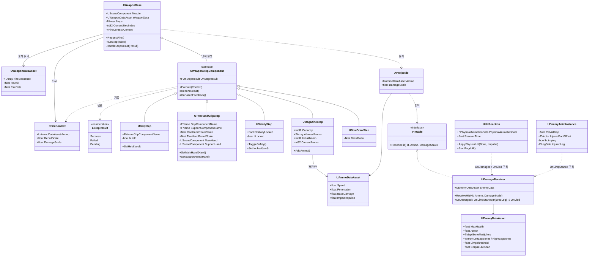

# 젠틀몬스터 VR 포트폴리오 계획서

> 대상 공고: [GENTLE MONSTER] Unreal Engine 게임 개발자 (뉴프로젝트 파트, VR 슈팅 어드벤처)
> 작성일: 2026-10-28 / 갱신: 2026-10-28 (Phase 1 설계 완료: 노출 범위, FFireContext, 클래스 구조도 반영)

---

## 1. 목표

### 1.1 무엇을 증명해야 하는가

- 19년 클라이언트 경력과 전투 시스템 전문성으로 "게임을 잘 만드는가"는 의심받을 가능성이 낮다.
- 공고 기준으로 가장 먼저 의심받을 지점은 **UE5 C++/Blueprint 실무 능숙도**다.
- "언리얼로 만들었다"는 사실만으로는 부족하다. **언리얼을 언리얼답게 쓴다**는 것을 보여줘야 한다.

### 1.2 공고와의 연결

| 공고 담당업무 | 포트폴리오에서 증명할 요소 |
|---|---|
| 적, 슈팅, 컴뱃 시스템 개발 | 컴포넌트 조합형 무기 시스템, 마네킹 적과의 전투 구간 |
| 물리 시뮬레이션과 물체 간 상호작용 | VR 손으로 무기를 집고 조작, 물리 기반 피격 반응 |
| 실험적 기능의 R&D 및 프로토타이핑 | C++ 수정 없이 컴포넌트 조합과 데이터만으로 새 무기 제작 |
| 외부 개발사 검수 및 관리 | 기획/외주가 만질 수 있는 영역과 보호되는 코어의 경계 설계 |

---

## 2. 설계 원칙

### 2.1 유니티의 기준을 언리얼 도구로 표현

| 원칙 | 유니티 | 언리얼 |
|---|---|---|
| 코어 보호, 노출 범위 통제 | 인스펙터 노출, 접근 제한 | C++ + `UPROPERTY(EditDefaultsOnly)`, `BlueprintReadOnly` 등 지정자 |
| 변수형 데이터 분리 | ScriptableObject | `UDataAsset` / `UPrimaryDataAsset` |
| 대량 표 형태 데이터 | SO 목록, CSV | `DataTable` (C++ 구조체 기반, CSV 임포트) |
| 조립과 튜닝 | 프리팹 + 컴포넌트 | 블루프린트 서브클래스 + 데이터 에셋 |

### 2.2 역할 분리

- **C++**: 코어와 규칙을 소유하고, 무엇을 열어줄지 선언으로 결정한다.
- **Blueprint / Data Asset**: 기획자와 외주사가 열린 부분만 조립하고 튜닝한다.
- **상수 vs 변수**: 고정 규칙은 보호한다. 반동, 연사 속도, 체력, 무게처럼 손맛을 좌우하는 값은 빌드 없이 조정 가능해야 한다.

---

## 3. 게임 콘셉트

**여러 총기를 직접 집어서 쏘는 VR 슈팅, 마네킹 적과의 짧은 전투 구간**

- "여러 총기" → 데이터 기반 설계 증명
- "직접 집어서" → 물리 상호작용 증명
- 무기는 수치만 다른 것이 아니라 **다루는 방식 자체가 달라야 한다**
  - 권총: 한 손, 외장 탄창 교체
  - 소총: 권총 구성 + 두 손 파지 (+ 안전장치)
  - 샷건: 두 손, 내장 탄창, 펌프 조작
  - 활: 탄창 없음, 시위를 당긴 거리만큼 위력 변화

---

## 4. 무기 시스템 구조

### 4.1 코어

- **발사 원점과 방향** (총열 위치 → "발사 원점"으로 일반화, 활까지 포함)
- 무기 데이터에 정의된 **발사 흐름 순서**를 읽고 컴포넌트를 차례로 실행한다.
- 컴포넌트의 구체 타입을 알지 못한다.

### 4.2 컴포넌트

- 탄창 유무, 탄창 방식, 한 손/두 손 파지는 **플래그가 아니라 컴포넌트의 존재 여부**로 표현한다 (ECS 발상).
- 예시: 탄창 컴포넌트(탄창 크기, 허용 탄 종류), 파지 컴포넌트(손 위치), 안전장치 컴포넌트, 시위 당김 컴포넌트, 충전 컴포넌트 등
- **새 기능은 새 컴포넌트로 추가한다.** 특정 무기에만 필요한 단계(예: 소총의 안전장치)도 기존 컴포넌트를 수정하지 않고 별도 컴포넌트로 만든다.
- 각 컴포넌트는 **"다음 단계"를 모른다.** 자기 작업만 수행하고 결과를 발행한다.

### 4.3 결정: 진행 순서 정보의 위치 ✅

- **흐름 순서는 무기 단위로, 무기 데이터에 한곳에 모은다.**
- 이유
  - 같은 컴포넌트를 여러 무기가 공유하므로, 순서는 컴포넌트가 아니라 **무기의 속성**이다.
  - 컴포넌트가 "다음"을 알면 순서 정보가 여러 컴포넌트에 흩어지고, 공유 컴포넌트 수정 시 다른 무기에 영향을 준다.
  - 한곳에 모여 있어야 기획자가 전체 흐름을 확인하고 바꾸기 쉽다.
  - PDF에서도 한 줄로 보여줄 수 있다. 예: `소총 = 파지 → 안전장치 → 탄창 → 발사`

### 4.4 결정: 코어와 컴포넌트의 계약 ✅

- 모든 단계 컴포넌트는 **공통 인터페이스**를 구현한다.
- 실행되면 다음 세 가지 중 하나를 **발행**하고, 코어는 **델리게이트로 구독**한다.

| 상태 | 의미 | 코어의 처리 | 예시 |
|---|---|---|---|
| **Success** | 이 단계 완료 | 다음 단계로 진행 | 파지 확인됨, 탄 있음 |
| **Failed** | 게임상 정상적인 거절 | 흐름 중단 | 안전장치 잠김, 탄 없음, 손 없음, 맞지 않는 탄 장전 |
| **Pending** | 완료 보고 대기 | 보고가 올 때까지 대기 | 활 시위 당기는 중 |

- "Error"는 버그와 예외 상황용으로 남겨두고, 게임 규칙상의 거절은 **Failed**로 구분한다.
- **구체적인 피드백은 상태를 발행한 컴포넌트가 책임진다.** (예: 탄창 컴포넌트가 Failed 발행과 함께 빈 격발음 재생) 코어는 끝까지 개별 컴포넌트의 사정을 모른다.
- **실패 피드백 호출은 부모가 보장한다.** ✅ `UWeaponStepComponent::Report`(비가상)가 `Failed`일 때 `OnFailedFeedback`(`BlueprintImplementableEvent`)을 호출한 뒤 결과를 발행한다. 자식은 `Report(Failed)`만 부르면 되므로 피드백 누락이 구조적으로 불가능하다. 피드백 내용은 각 단계 블루프린트가 이벤트를 구현해 정하고, 피드백이 필요 없는 단계는 구현하지 않는다. 한 단계 안에서 실패 이유별로 다른 피드백이 필요해지면 `OnFailedFeedback`에 이유를 넘기는 방향으로 확장한다.
- 비동기 단계(Pending)가 있으므로 즉시 반환형 함수 호출보다 발행/구독 방식이 적합하다.
- 공통 계약은 `UInterface`가 아니라 **추상 컴포넌트 클래스 `UWeaponStepComponent`** 로 구현한다. 모든 단계가 액터 컴포넌트이고, 델리게이트와 공통 보고 함수를 부모에 한 번만 구현하면 되기 때문이다.

### 4.5 결정: FFireContext 규칙 ✅

- 코어가 단계 컴포넌트의 구체 타입을 모른 채 발사에 필요한 정보를 얻기 위한 **공용 보고서 구조체**. 각 단계가 흐름 중에 기록하고, 코어는 마지막에 읽어 발사한다.
- 단계 컴포넌트와 코어가 **공유해야 하는 정보만** 담는다. 단계끼리만 쓰는 정보나 단계 내부 상태는 넣지 않는다.
- 칸 이름은 **코어가 쓰는 의미**로 짓는다. (`DrawRatio` ✗ → `DamageScale` ✓) 그래야 새 무기 유형이 생겨도 구조체가 늘어나지 않는다.

| 칸 | 의미 | 기록하는 단계 예시 |
|---|---|---|
| `Ammo` | 발사할 탄 데이터 | 탄창 |
| `RecoilScale` | 반동 배율 | 두 손 파지 |
| `DamageScale` | 피해 배율 | 활 시위 당김, 충전식 무기 |

### 4.6 클래스 구조도 (초안)

**구조도에서 확인할 점**
- `AWeaponBase`는 추상 타입 `UWeaponStepComponent`만 알고, 구체 단계 클래스와 직접 연결되지 않는다. 새 단계는 상속선만 늘어난다.
- 무기 시스템과 적 시스템은 `AProjectile`이 탄 데이터를 전달하는 지점에서만 만난다. 피해 계산은 `UDamageReceiver`에서 처리한다.
  - **만나는 지점은 인터페이스 `IHittable`이다.** ✅ 무기 쪽(`Weapon/Hittable.h`)이 정의하고 투사체는 이것만 안다. 의존 방향은 적 → 무기 한쪽뿐이다(6.5).
- 메시 교체를 위해 발사 원점, 파지 위치, 탄창 결합부는 이름이 정해진 소켓 또는 Scene Component로 두고, 컴포넌트는 그 이름으로만 위치를 찾는다.
  - **발사 원점 `Muzzle`은 코어(`AWeaponBase` 생성자)가 만든다.** ✅ 모든 무기에 빠짐없이 있고, 블루프린트는 위치만 옮긴다. 투사체는 `Muzzle`의 앞 방향(X)으로 나간다.
  - **무기 루트는 코어가 만드는 박스 충돌체 `Body`다.** ✅ 메시, 잡기 컴포넌트, `Muzzle`은 모두 그 아래에 둔다. 루트가 빈 Scene Component면 템플릿 잡기가 루트 아래의 메시만 손에 붙여 `Muzzle`이 제자리에 남는다. 충돌체 루트는 메시 종류(스태틱/스켈레탈)와 무관하고, 놓을 때 물리도 루트에 걸린다.

### 4.7 결정: 파지와 잡기 시스템 ✅

- **잡기 자체(손 근처 탐색, 컨트롤러에 붙이기, 햅틱, 물리)는 잡기 시스템이 맡는다.** 파지 단계는 잡혔다/놓였다는 결과만 듣고, 발사 흐름에서 파지 상태를 검사한다. 발사 단계와 상호작용 처리를 한 클래스에 섞지 않는다.
- **잡기 시스템은 VR 템플릿의 `BP_GrabComponent`와 `BP_XRPawn`을 그대로 쓴다.** 손 탐색과 붙이기를 다시 만들지 않는다. C++은 블루프린트 클래스를 참조할 수 없으므로, 템플릿과의 연결은 `UGripStep`의 블루프린트 자식(`BP_GripStep`)이 맡는다.
- **파지 상태의 원본은 `UGripStep::bHeld`다.** `OnGrabbed`/`OnDropped`가 올 때 `SetHeld`(`BlueprintCallable`)로 갱신하고, `Execute`는 `bHeld`만 본다. 노출 규칙(상태값은 `VisibleInstanceOnly`, 변경은 함수로만)을 따른다.
- **`BP_GripStep`은 이름으로 자기 잡기 컴포넌트를 찾는다.** `GripComponentName`과 같은 이름의 `BP_GrabComponent`를 `BeginPlay`에서 찾아 스스로 구독한다. 무기마다 배선하지 않으며, 두 손 무기(주 손잡이 + 보조 손잡이)도 이름만 달리 설정한다. 잡기 컴포넌트가 곧 파지 위치(Scene Component)다.
- **템플릿 잡기는 액터가 아니라 잡기 컴포넌트의 부모 컴포넌트를 손에 붙인다.** 그래서 주 손잡이 잡기 컴포넌트는 루트 `Body` 바로 아래에 둔다. 보조 손잡이는 Step 5 이후 두 손 파지에서 따로 다룬다.
- **트리거 입력은 무기가 받는다.** ✅ 템플릿 권총처럼 잡힐 때 잡은 손의 입력 매핑을 켜고 놓을 때 끈다. Pawn은 고치지 않는다.
- **트리거 입력은 발사 단계가 아닌 입력 전용 컴포넌트 `UTriggerInputComponent`가 맡는다.** ✅ 단계의 `Execute`는 `RequestFire` 이후에 실행되므로, 트리거를 단계로 두면 판단할 일이 없다. 입력 컴포넌트는 `RequestFire`를 부르기만 한다. 템플릿과의 연결(어느 손인지)은 블루프린트 자식 `BP_TriggerInput`이 `GripStep`과 같은 방식(이름으로 잡기 컴포넌트를 찾아 구독)으로 한다. 반자동/자동 같은 발사 모드는 필요해질 때 따로 정한다.

### 4.8 결정: 그레이박스 권총과 발사 피드백 ✅

- **권총은 테스트 무기와 별도의 블루프린트(`BP_PistolWeapon`)와 데이터 에셋(`DA_Pistol`)으로 만든다.** 필요한 부품만 붙여 `권총 = 파지 → 탄창 → 발사`가 그대로 보이게 한다. `BP_TestWeapon`은 더미 단계 실험용으로 남긴다.
- **기준점은 `Muzzle`(코어), `Grip`(잡기 컴포넌트), `MagazineWell`(Scene Component) 세 개다.** `MagazineWell`은 자리만 두고, 위치를 쓰는 코드는 탄창 교체를 만들 때 연결한다.
- **코어는 발사할 때 `OnFired(Recoil)` 델리게이트만 발행한다.** 반동 세기는 `Recoil × RecoilScale`이다. 구체적인 발사 피드백은 이 이벤트를 구독하는 컴포넌트가 맡는다(설계 규칙 4).
- **발사 햅틱은 잡은 손을 아는 `UTriggerInputComponent`가 `OnFired`를 구독해서 준다.** 세기는 반동 세기(0~1로 제한)다. 눈에 보이는 반동(총이 튀었다 돌아오기)은 손맛 조정 단계에서 따로 다룬다.

### 4.9 결정: 안전장치 ✅

- **안전장치는 발사 단계 `USafetyStep`이다.** 잠겨 있으면 `Failed`, 풀려 있으면 `Success`. 잠김 피드백은 `OnFailedFeedback`으로 블루프린트 자식(`BP_SafetyStep`)이 정한다. 걸고 풀 때의 피드백(딸깍 소리 등)은 `OnSafetyChanged(bLocked)`(`BlueprintImplementableEvent`)로 같은 자식이 정한다.
- 잠금 상태 `bLocked`는 실행 중 상태값이고 변경은 `SetLocked`/`ToggleSafety`로만 한다. 배치 시 처음 상태는 배치별 초기값 `bInitiallyLocked`(`EditInstanceOnly`, 기본 잠김)다.
- **VR에서는 무기를 잡은 손의 A/X 버튼으로 토글한다.** 템플릿이 쓰지 않는 버튼(`OculusTouch_Right_A_Click`, `OculusTouch_Left_X_Click`)이다. 트리거처럼 잡을 때 그 손의 입력 매핑을 켜고 놓을 때 끈다. 시뮬레이터에서는 `B` 키다.
- **버튼은 단계가 아니라 입력 컴포넌트가 받는다(4.7).** 트리거와 안전장치 입력의 공통부분(잡은 손의 매핑 켜고 끄기, 버튼 바인딩, 무기 액터 입력 켜고 끄기)을 추상 부모 `UWeaponInputComponent`로 꺼내고, 자식은 버튼이 눌렸을 때 할 일만 구현한다. `UTriggerInputComponent`는 `RequestFire`, `USafetyInputComponent`는 같은 액터의 `USafetyStep::ToggleSafety`를 부른다. 무기 액터의 입력은 켜진 입력 컴포넌트가 하나도 없을 때만 끈다.
  - 부모는 `EnableForHand`/`DisableForHand`, 손별 `LeftContext`/`RightContext`와 `LeftAction`/`RightAction`을 갖고, 자식은 `HandleAction`만 재정의한다. 트리거 쪽에서 바뀐 이름(`DisableTrigger`, `Left/RightFireAction`)은 `DefaultEngine.ini`의 `[CoreRedirects]`로 기존 블루프린트에 잇는다.
  - 입력 매핑 `IMC_Safety_Left/Right`는 OpenXR이 세션 시작 때 액션을 만들 수 있게 `Default Mapping Contexts`에 등록한다(`Add Immediately` 끔, 켜고 끄기는 입력 컴포넌트가 한다).
- 어느 손인지는 지금처럼 입력 컴포넌트의 블루프린트 자식(`BP_TriggerInput`, `BP_SafetyInput`)이 각자 잡기 컴포넌트를 구독해 판별한다. C++ 형제 클래스라 그래프를 물려받지 못해 복제되므로, 입력 컴포넌트가 더 늘면 `UGripStep`이 잡은 손도 발행하는 방식을 다시 검토한다.

### 4.10 결정: 두 손 파지 ✅

- **보조 손은 발사 조건이 아니다.** `UTwoHandGripStep`은 항상 `Success`이고, 두 손이면 작은 `RecoilScale`, 한 손이면 큰 `RecoilScale`을 `FFireContext`에 기록한다. 발사 흐름을 멈추지 않는 첫 단계다. 배율 두 값은 단계 컴포넌트의 설정값(`EditDefaultsOnly`)이다.
- **보조 손을 잡으면 두 손 조준을 한다.** 총구 방향을 주 손잡이에서 보조 손 쪽으로 매 틱 맞춘다. 조준도 `UTwoHandGripStep`이 직접 맡는다(두 손 파지에 관한 상태와 동작을 한 컴포넌트에 모은다). 두 손일 때만 틱을 켠다.
- **두 손 상태에서 주 손만 놓으면 보조 손이 무기를 이어받는다.** 무기는 보조 손에 붙은 채 남고, 트리거 입력은 주 손잡이를 따라 꺼진다. 보조 손까지 놓으면 무기가 떨어진다.
  - ✅ (5-3c) **주 손 없이 보조 손잡이만 잡아도 무기가 보조 손에 들린다.** 이어받기와 같은 상태로 본다: "보조 손만 잡고 있음"이면 붙이고(월드 위치 유지), 그 상태에서 주 손잡이를 잡으면 템플릿이 주 손에 다시 붙이고 두 손 조준으로 돌아가며, 보조 손을 놓으면 떼고 물리를 켠다. 트리거는 주 손잡이를 잡아야 켜지므로 보조 손만으로는 쏠 수 없다.
- 보조 손잡이도 템플릿 잡기 컴포넌트지만 **무기를 손에 붙이지 않는 잡기 종류**로 둔다. 붙이면 두 번째 손이 무기를 빼앗아 간다. 템플릿과의 연결은 `BP_GripStep`처럼 블루프린트 자식(`BP_TwoHandGripStep`)이 이름(`GripComponentName`, `SupportComponentName`)으로 두 잡기 컴포넌트를 찾아 구독한다.
  - 템플릿 `BP_GrabComponent` 분석: `Custom` 잡기는 `IsHeld`와 `MotionControllerRef`(잡은 손)만 기록하고 `OnGrabbed`·햅틱을 낸다. 물리를 끄거나 붙이지 않는다. 놓을 때도 `IsHeld = false` 후 `OnDropped`만 낸다. Free/Snap 놓기는 잡기 컴포넌트의 부모(`Body`)를 손에서 떼고 `bSimulateOnDrop`이면 물리를 켠다. `GetHeldByHand`는 `MotionControllerRef`의 `MotionSource` 앞 네 글자로 판별하므로 `Custom`에서도 맞다.
  - 그래서 이어받기(5-3c)에서는 주 손이 떨어질 때 템플릿이 뗀 무기를 보조 손에 다시 붙이고, 보조 손까지 놓을 때 떼고 물리를 되돌리는 일을 직접 한다.
  - 단계는 손을 `SetMainHand`/`SetSupportHand(USceneComponent*)`로 받는다(놓이면 None). 블루프린트 자식이 두 잡기 컴포넌트의 `MotionControllerRef`를 넘긴다.
  - 두 손 조준(5-3b): 조준을 시작할 때 무기 루트가 붙은 부모(주 손)와 상대 트랜스폼을 저장하고, 매 틱 그 한 손 자세에서 출발해 주 손잡이를 축으로 "주 손잡이 → 보조 손잡이" 방향을 "주 손잡이 → 보조 손" 방향으로 돌린다(최소 회전이라 손목 비틀기는 주 손을 따른다). 지난 프레임 결과에 누적하지 않으므로 오차가 쌓이지 않고, 보조 손을 놓으면 저장한 상대 트랜스폼으로 한 손 자세를 되돌린다. 손 위치가 갱신된 뒤 계산하도록 `TG_PostPhysics`에서 틱한다.
- 스텝은 셋으로 나눈다: 보조 손 상태와 반동 배율 → 두 손 조준 → 보조 손 이어받기.

### 4.11 결정: 발사 모드(단발/연발) ✅

- **연발은 트리거 쪽(입력 컴포넌트)이 맡는다.** 실제 총에서도 연사 여부는 가스 장치가 아니라 방아쇠 뭉치(디스커넥터, 자동 시어)와 조정간이 정한다. 가스 후퇴는 반자동 소총에도 있다.
- 발사 단계는 "이번 한 발을 쏠 수 있는가, 어떤 값으로 쏘는가"만 판단한다. 단계가 발사 뒤 `RequestFire`를 다시 부르면 흐름을 스스로 재시작하게 되어 "단계는 다음을 모른다"는 규칙과 어긋나고, 방아쇠가 눌려 있는지는 입력 컴포넌트만 안다.
- 연발은 "누르고 있는 동안 `RequestFire`를 반복 요청"이고, 속도 제한은 코어의 `FireRate` 쿨다운이 이미 지킨다. 탄 소모·안전장치·반동 배율은 매 발 기존 단계가 그대로 처리한다.
- 무기가 쓸 수 있는 발사 모드는 트리거 컴포넌트의 설정값(`EditDefaultsOnly`), 현재 모드는 실행 중 상태값이다. 모드 전환 버튼(조정간)을 안전장치와 합칠지는 그때 정한다.
- 단계가 맞는 곳은 약실 상태다: 볼트액션은 "약실이 비었으면 Failed" 단계 + 손으로 장전. 소총 종류는 `볼트액션 = 단발 트리거 + 약실 단계`, `반자동 = 단발 트리거`, `자동 = 연발 가능 트리거 (+ 조정간)`으로 조립한다.
- 스텝: 5-4a 단발 소총(새 C++ 없음) → 5-4b 트리거 발사 모드.
- ✅ (5-4b) **조정간은 A/X 하나로 `안전 → 단발 → 연발 → 안전`을 돌린다.** 새 입력 컴포넌트 `USelectorInputComponent`가 맡고, 위치 목록은 "안전(같은 액터에 `USafetyStep`이 있을 때만) + 트리거의 `FireModes` 순서"다. 잠김은 `USafetyStep`, 모드는 `UTriggerInputComponent`가 그대로 가진다. 안전장치 입력(`USafetyInputComponent`)은 남겨 두고, 연발 소총에만 그 대신 조정간을 붙인다.
- ✅ **연발 중 한 발이 Failed면 반복을 멈추고, 다시 당겨야 쏜다.** 코어가 `OnFireAborted`를 발행하고 트리거가 구독한다. 반복은 트리거가 연발 중에만 틱을 켜고 코어의 `CanRequestFire()`(진행 중 아님 + `FireRate` 간격 지남)가 참일 때 `RequestFire`를 부른다.
- 놓음을 알아야 하므로 입력 부모가 `Completed`도 바인딩한다(`HandleActionReleased`, 입력이 꺼질 때도 호출). 템플릿 `IA_Shoot_*`은 `Pressed` 트리거라 누른 다음 프레임에 `Completed`가 와서 쓸 수 없다 → 트리거 없는 `IA_Fire_*`/`IMC_Fire_*`를 새로 만든다. 템플릿 `IMC_Weapon_*`(우선순위 0, 항상 켜짐)이 같은 키를 먼저 소비하지 않도록 무기 입력 매핑은 우선순위 1로 넣는다.

### 4.12 결정: 레이저 사이트 ✅

- 시뮬레이터에서 조준하기 어려워서 만든 조준 보조 부품이다. 발사 단계가 아니며, 붙이면 생기고 떼면 사라진다. 코어와 단계는 모른다.
- **잡았을 때만 켠다.** 잡기 감지는 기존 입력·파지 부품과 같이 BP 자식(`BP_LaserSight`)이 템플릿 잡기 컴포넌트의 `OnGrabbed`/`OnDropped`를 구독해 C++ 부모 `ULaserSightComponent`(추상)의 `SetLaserEnabled`를 부른다. 템플릿 의존은 BP에만 남는다.
- **나이아가라 빔으로 그린다.** 부품이 BeginPlay에서 `Muzzle`(이름으로 찾음)에 나이아가라 컴포넌트를 붙이고, 켜져 있는 동안 틱에서 `Muzzle` 앞으로 트레이스해 시작·끝 위치를 User Parameter로 넘긴다. 빔 에셋은 엔진 이미터 템플릿 `DynamicBeam`(매 프레임 끝점을 다시 계산)에서 시작한다.
- 트레이스는 탄과 같은 대상(월드, 적 메시)을 맞히고 `Pawn`(적 캡슐, 플레이어 몸)과 무기 자신은 무시한다. 맞은 곳이 없으면 최대 거리까지 그린다.
- 빔 에셋·최대 거리·`Muzzle` 이름·파라미터 이름은 부품 설정값(`EditDefaultsOnly`)이다.

---

### 4.13 결정: 탄창 교체 ✅

- **탄의 원본은 집는 탄창 액터 `AMagazine`이다.** 탄 종류(`AmmoType`)·장탄수(`Capacity`)는 탄창 설정값, 처음 든 탄 수(`InitialRounds`)는 배치별 값, 남은 탄(`Rounds`)은 상태다. `UMagazineStep`은 "지금 끼워진 탄창"을 가리키고 발사 때 거기서 한 발을 꺼낸다(없으면 `No magazine`, 비면 `Empty`로 Failed). 빼낸 탄창은 남은 탄을 그대로 갖는다. "탄을 따라가는 값은 탄에" 규칙의 연장이고, 2-2의 `UMagazineStep::Capacity`·`AllowedAmmo`·`InitialAmmo`·`AddAmmo`는 탄창으로 옮기거나 없앤다.
- **맞는 탄창은 탄창 종류 목록으로 정한다.** `UMagazineStep::AllowedMagazines`(탄창 클래스 목록, `IsA`로 검사)에 든 탄창만 들어간다. 권총 탄창은 권총에만 맞는다. 탄 종류는 탄창이 정한다.
- **끼우기는 `MagazineWell` 근처에서 탄창을 놓을 때다.** 탄창 BP가 잡기 컴포넌트의 `OnDropped`를 구독해 `TryInsertNearby`를 부르면, 근처 무기의 `UMagazineStep`이 자기 `MagazineWell`까지 거리(`InsertRadius`)와 호환을 확인하고 받아들인다. 방향은 보지 않는다(시뮬레이터에서 각도 맞추기가 어렵다). 끼워진 탄창은 물리·충돌을 끄고, 탄창의 윗면 표시 `MagazineTop`(Scene Component)이 `MagazineWell`에 오도록 붙는다. 루트 충돌체는 물리로 움직여야 해서 원점을 윗면으로 옮길 수 없기 때문에 이름 있는 기준점을 둔다(규칙 8).
- **빼기는 무기를 잡은 손의 B/Y 버튼이다.** 입력 컴포넌트 `UMagazineReleaseInputComponent`(`UWeaponInputComponent` 자식)가 `UMagazineStep::EjectMagazine`을 부르고, 탄창은 떼어져 물리로 떨어진다. 떨어지는 동안 잠깐 무기 몸체(`PhysicsBody`)와 충돌을 무시해 튕기지 않게 한다.
- **레벨에 놓인 무기는 탄창이 끼워진 채 시작한다.** `UMagazineStep`의 배치별 값 `InitialMagazine`(탄창 클래스)을 `BeginPlay`에서 스폰해 끼운다. 비워 두면 빈 무기다.
- 스텝: 6-7a 탄창 액터와 탄의 원본 이동(초기 탄창, 발사 회귀) → 6-7b 놓아서 끼우기 → 6-7c 버튼으로 빼기.

## 5. 데이터 구조

### 5.1 결정: 데이터 위치 ✅

판단 기준: **"이 값은 무엇이 바뀔 때 같이 바뀌는가?"**

| 위치 | 담는 값 | 판단 근거 |
|---|---|---|
| 무기 데이터 에셋 | 발사 흐름 순서, 반동, 연사 속도 | 무기가 바뀌면 같이 바뀜 |
| 컴포넌트 속성 (무기 블루프린트 내) | 파지 위치, 탄창 크기, 허용 탄 종류 | 해당 무기의 메시와 구성에 묶여 있음 |
| 탄 데이터 에셋 | 투사체 클래스, 탄속, 관통력, 기본 피해 | 어떤 무기에 넣든 탄을 따라감 (탄을 바꾸면 투사체 모양도 바뀜 ✅) |
| 적 데이터 | 부위별 피해 배율, 방어력, 상태 변화 기준 | 맞은 대상과 부위를 따라감 |

### 5.2 피해 계산

- **최종 피해 = 탄 데이터(기본 피해, 관통력) × 적 데이터(부위 배율, 방어력)**
  - ✅ `최종 피해 = BaseDamage × 본 배율 × DamageScale × min(1, Penetration / Armor)` (방어력 0이면 계수 1)
- 두 데이터가 만나는 계산은 **피격 쪽에서** 처리한다. 무기 시스템과 적 시스템이 서로를 모른 채 동작한다.
- 맞지 않는 탄 장전(예: 권총에 소총탄)은 탄창 컴포넌트가 허용 탄 종류를 확인해 **Failed**로 처리한다.
  - 장전은 발사 흐름 밖의 동작이라 `AddAmmo`가 실제로 넣은 수를 돌려주고, 거절이면 0을 돌려준다. (Error가 아닌 규칙상 거절이라는 점은 같다)
- **탄창 하나에는 한 종류의 탄만 들어간다.** ✅ 탄창 상태는 `LoadedAmmo`(종류) + `CurrentAmmo`(수)다. 남은 탄과 다른 종류는 탄창이 비었을 때만 넣을 수 있다.
- **배치 시 초기 탄 종류는 `AllowedAmmo`의 첫 번째 항목이다.** ✅ 배치별로는 `InitialAmmo`(수)만 정하고, `BeginPlay`에서 `AddAmmo`를 거쳐 채워 같은 규칙으로 검사한다.

### 5.3 결정: 노출 범위 ✅

| 값의 종류 | 예시 | 에디터 수정 | 블루프린트 그래프 | 변경 경로 |
|---|---|---|---|---|
| 무기 종류 공통 설정값 | 반동, 연사 속도, 장탄수, 발사 흐름 순서 | `EditDefaultsOnly` (데이터 에셋/클래스에서만) | `BlueprintReadOnly` | 데이터 에셋 수정 |
| 탄 설정값 | 탄속, 관통력, 기본 피해 | 탄 데이터 에셋에서만 | `BlueprintReadOnly` | 데이터 에셋 수정 |
| 배치별 초기값 | 초기 탄 수 | `EditInstanceOnly` (+ 스폰 시 `ExposeOnSpawn`) | 노출 불필요 | 배치 또는 스폰 시점 |
| 실행 중 상태값 | 현재 탄 수, 안전장치 잠김 여부, 파지 상태 | `VisibleInstanceOnly` (디버그 확인용) | `BlueprintReadOnly` | `BlueprintCallable` 함수로만 (규칙 검사 포함) |
| 컴포넌트 피드백 | 빈 격발음, 잠김 표시 | — | `BlueprintImplementableEvent` 등 | 블루프린트가 연출을 덧붙임 |

**원칙**
- 무기 종류 전체가 같아야 하는 값은 인스턴스에서 수정할 수 없게 막는다. (프리팹 오버라이드 문제 방지)
- 시스템이 바꾸는 상태값은 읽기만 허용하고, 변경은 규칙을 강제하는 함수로만 연다. (예: `AddAmmo`가 장탄수 제한과 허용 탄 종류를 검사)
- 배치마다 달라도 되는 건 **초기값**뿐이고, 초기값과 현재값은 별도 속성으로 분리한다. C++ 생성자는 클래스 기본 객체(CDO)용이므로, 배치별 초기값은 속성으로 받아 `BeginPlay`에서 현재값으로 옮긴다.

---

## 6. 적 시스템

### 6.1 적 구성

- UE5 기본 마네킹(Manny / Quinn) 사용. 심사자가 보는 것은 외형이 아니라 시스템이다.
- 무기와 추가 캐릭터는 Fab 무료 에셋에서 선택한다.

### 6.2 반응 설계 (무기 차이를 눈에 보이게 만드는 장치)

- **탄착 부위에 따른 부분 피해**
- **관통력에 따른 피해 차이** (예: 권총은 더 많이 맞춰야 피해가 쌓임)

### 6.3 표현 방식

| 방식 | 채택 | 비고 |
|---|---|---|
| 부위별 피격 애니메이션 애디티브 | ✗ | 애니메이션 에셋 부담 |
| 물리 기반 피격 반응 | ✓ | `PhysicalAnimationComponent` 또는 맞은 본 아래만 `SetAllBodiesBelowSimulatePhysics` 후 블렌딩. 추가 애니메이션 불필요, 공고의 물리 시뮬레이션 업무와 직접 연결 |
| 상태 변화 | ✓ | 다리 피격 시 절뚝임 등, 애니메이션 블루프린트 상태 전환 |
| 부분 파괴 | ✗ | 범위에서 제외 |

### 6.4 결정: 적 데이터 ✅

- **부위 배율은 본마다 둔다.** `BoneMultipliers`(`TMap<본 이름, 배율>`)에 적고, 없는 본은 1.0이다. 키는 피직스 에셋에 바디가 있는 본 이름이다(Hit 결과에는 그 본만 들어온다). 1.0이 아닌 본만 적으면 된다.
- **방어력은 비율로 반영한다.** 관통력이 방어력 이상이면 100%, 모자라면 `관통력 / 방어력`만큼 들어간다. 피해가 0이 되지 않아 약한 탄은 "더 많이 맞춰야" 한다(6.2). 공식 계산은 `UDamageReceiver`가 한다.
- **절뚝임은 다리 누적 피해(절대값)로 판단한다.** 다리 본 목록 `LeftLegBones`·`RightLegBones`에 든 본에 들어간 최종 피해의 합이 `LimpThreshold` 이상이면 절뚝인다. 좌우 다리는 합쳐서 센다(목록을 좌우로 나눈 이유는 6.7). 방어력과 관통력이 그대로 반영되고, 체력을 바꿔도 기준은 그대로다.
- **최대 체력 `MaxHealth`도 적 데이터에 둔다.** 현재 체력은 `UDamageReceiver`의 상태값이다.

### 6.5 결정: 피격 전달과 결과 알림 ✅

- **투사체는 인터페이스 `IHittable`로 피해를 넘긴다.** 투사체가 적 클래스를 include하지 않는다. 기본 데미지 경로(`ApplyPointDamage`)는 숫자 하나만 넘겨서 관통력·방어력을 받는 쪽에서 계산하려면 적이 투사체를 캐스트해야 하므로 쓰지 않는다.
- **인터페이스는 컴포넌트(`UDamageReceiver`)가 구현한다.** 투사체는 맞은 액터에서 `FindComponentByInterface<IHittable>()`로 찾는다. 적 블루프린트는 컴포넌트를 붙이기만 하면 되고 전달 노드를 이을 필요가 없다. 컴포넌트 없는 대상(상자 등)이 생기면 투사체에 "액터가 구현했는지 먼저 보기"만 더한다.
- **`UDamageReceiver`는 결과를 델리게이트로 발행만 한다.** `OnDamaged(본, 피해, Hit)`, `OnLimpStarted`, `OnDied`. 피격 반응(`UHitReaction`), 애니메이션 상태, 사망 연출이 각자 구독한다. 무기의 `OnFired` → `UTriggerInputComponent`(햅틱)와 같은 모양이다.
- 사망한 뒤의 피격은 무시한다. 치명타가 다리에 맞아도 절뚝임 대신 사망만 발행한다.

### 6.6 결정: 물리 피격 반응 ✅

- **맞은 본 아래 바디만 물리로 돌리고 `UPhysicalAnimationComponent`로 애니메이션 자세 쪽에 당긴다.** 블렌드 가중치만 쓰면 물리 구간에서 부위가 힘 빠진 래그돌처럼 처지므로, 모터로 버티다 돌아오게 한다. 모터는 월드 기준(`bIsLocalSimulation` 끔)이라 골반을 맞으면 몸 전체가 흔들리되 쓰러지지 않는다.
  - 이를 위해 메시의 `PhysicsTransformUpdateMode`를 `ComponentTransformIsKinematic`으로 둔다(`UHitReaction`이 `BeginPlay`에서 설정). 기본값은 루트 바디(골반)가 물리로 돌면 컴포넌트가 그 바디를 따라가는데, 그러면 월드 기준 목표 자세도 함께 움직여 골반을 되돌릴 힘이 없고 반응이 끝난 뒤에도 액터가 돌아간 채 남는다.
- 블렌드 가중치는 `RecoverTime` 동안 1 → 0으로 줄이고, 끝나면 물리를 끈다. 반응 중인 부위 안쪽을 다시 맞으면 그 반응을 다시 시작하고, 바깥(조상 본)을 맞으면 안쪽 반응을 흡수한다.
- **충격량 = 탄의 `ImpactImpulse` × (최종 피해 / `BaseDamage`).** 탄마다 미는 세기를 정하면서(탄을 따라가는 값, 5.1) 부위 배율·`DamageScale`·방어력도 밀림에 반영된다(6.2). 단위는 속도 변화(cm/s)라 바디 질량과 무관하다.
- `OnDamaged`는 탄 데이터도 함께 넘긴다: `OnDamaged(본, 피해, Hit, Ammo)`.

### 6.7 결정: 절뚝임 상태 ✅

- **절뚝임 자세는 절차적 보정으로 만든다.** 쓸 수 있는 애니메이션(Idle, 나중에 Walk) 위에서 골반을 내리고 다친 발의 IK 목표를 들어 올린 뒤 `Leg IK`로 두 다리를 푼다. 성한 발은 제자리에 붙어 무릎이 굽고, 다친 다리는 들린다. 절뚝임 애니메이션 에셋이 필요 없고 Phase 4의 걷기에도 같은 보정을 얹는다.
- **다친 다리는 절뚝임을 시작시킨 탄이 맞은 쪽이다.** 누적 판단은 좌우 합산(6.4) 그대로 두고, 좌우는 적 데이터의 `LeftLegBones`/`RightLegBones`로 구분한다. 판단이 데이터에만 있어 메시나 본 이름 규칙을 몰라도 된다. `OnLimpStarted(InjuredLeg)`로 넘긴다.
- **애니메이션 블루프린트는 C++ 부모 `UEnemyAnimInstance`가 `OnLimpStarted`를 구독해서 상태를 안다.** 상태값을 매 프레임 읽지 않고 다른 반응과 같은 "발행하고 구독" 모양을 따른다. 부모가 골반·발 오프셋을 `LimpBlendTime` 동안 0에서 목표값까지 계산해 두고, 애님 그래프는 그 값을 노드에 꽂기만 한다.
- 오프셋 크기(`PelvisDrop`, `InjuredFootOffset`)는 스켈레톤 자세에 묶인 값이라 애니메이션 블루프린트의 클래스 기본값에 둔다.
- 상태 머신은 쓰지 않는다. 절뚝임은 재생 중인 애니메이션을 바꾸지 않고 위에 얹는 보정이라, 전환은 `LimpAlpha` 블렌드로 충분하다. 걷기 상태 머신은 Phase 4에서 이 보정 앞단에 둔다.

### 6.8 결정: 사망 처리 ✅

- **사망은 전신 래그돌이다.** 모든 바디를 물리로 돌리고 `PhysicalAnimation` 모터를 끈다(`SetStrengthMultiplyer(0)`). 치명타는 `OnDamaged` → `OnDied` 순서로 발행되므로 마지막 탄의 충격량이 먼저 들어가고, 쓰러지는 모양이 맞은 부위와 방향을 따른다. 사망 애니메이션 에셋은 쓰지 않는다(6.3).
- **래그돌은 `UHitReaction`이 맡는다.** 치명타도 피격 반응을 시작시키므로, 다른 컴포넌트가 래그돌을 켜면 `UHitReaction`의 복귀 틱이 그 부위의 물리를 다시 끈다. 메시의 물리를 만지는 컴포넌트를 하나로 두어 이 충돌을 구조적으로 없앤다. `OnDied`를 받으면 진행 중인 반응을 비우고 틱을 끈 뒤 래그돌로 넘어가고, 그 뒤의 `ApplyPhysicalHit`은 무시한다.
- 사망 후 피격은 지금처럼 무시한다(6.5). 쓰러진 몸에 탄이 맞아도 피해도 밀림도 없다.
- **쓰러진 몸은 적 데이터의 `CorpseLifeSpan`(초) 뒤에 없앤다.** 0이면 남긴다. 액터 수명은 사망 상태를 관리하는 `UDamageReceiver`가 사망 시 `SetLifeSpan`으로 건다.

### 6.9 결정: 전투 구간 (Phase 4) ✅

- **적은 플레이어에게 다가와 공격하고, 플레이어 체력이 0이면 구간 실패다.** "다가오는 수준"에서 한 단계 올려 지는 조건을 둔다. 쏘는 쪽만 있는 사격장이 아니라 "막지 못하면 맞는" 전투가 되어야 무기 선택과 부위 사격(절뚝임으로 늦추기)에 의미가 생긴다.
- **적의 판단은 State Tree로 만든다.** 추적 → 공격 거리면 공격 → 다시 추적. 이동은 내비메시 + AI 컨트롤러의 MoveTo, 행동은 C++ Task. UE5에서 에픽이 미는 범용 계층 상태 머신을 쓴다.
- **공격 판정은 타격 순간 주먹 주변 ↔ 플레이어 머리(HMD)다.** 공격 애니메이션(`MM_Attack_01~03`)의 타격 프레임에 Anim Notify로 주먹 본 주변 구와 HMD 위치를 비교한다. VR에서는 몸을 기울여 피할 수 있어야 하고, 타이밍은 애니메이션 에셋이 정한다.
- **피해는 언리얼 기본 데미지로 전달한다.** `UGameplayStatics::ApplyDamage` → 플레이어 액터의 `OnTakeAnyDamage`를 플레이어 체력 컴포넌트가 구독한다. 총알 경로(`IHittable`, 4.6·6.5)는 건드리지 않아 "무기와 적은 투사체에서만 만난다"는 경계가 그대로다.
- **적의 몸은 C++ `AEnemyCharacter`(`ACharacter` 상속)다.** 캡슐 루트 아래 메시를 두고, 기존 `UDamageReceiver`·`UPhysicalAnimationComponent`·`UHitReaction`을 생성자에서 만든다. 사망 시 캡슐 충돌·이동 정지 같은 몸 공통 처리를 맡는다. 무기의 `AWeaponBase`처럼 적에도 코어가 생기지만, 반응·피해 판단은 여전히 컴포넌트에 있다.
- **구간은 웨이브 데이터로 진행한다.** 데이터 에셋에 웨이브 목록(적 종류·수·간격)을 적고, 한 웨이브를 다 쓰러뜨리면 다음 웨이브, 마지막 웨이브가 끝나면 승리. 무기처럼 내용은 데이터, 규칙은 C++이다.
- **탄 보급은 탄창 교체다.** 탄창을 따로 집는 액터로 만들고 `MagazineWell`에 끼우면 장전된다(3장 "권총: 외장 탄창 교체"). 탄의 원본을 탄창 액터로 옮길지 등 세부는 그 스텝에서 정한다.
- 걷기는 `BS_Idle_Walk_Run`(Third Person 팩) 위에 기존 절뚝임 보정(6.7)을 얹는다. 새 애니메이션 에셋은 쓰지 않는다.

**추적 (Step 6-3)**

- **적이 쫓는 목표는 플레이어 머리(HMD) 아래 바닥이다.** VR 폰의 액터 위치는 트래킹 원점(플레이 공간 바닥)이라, 플레이어가 방 안에서 움직이면 폰 위치와 실제 플레이어가 어긋난다. 카메라 위치를 폰 바닥 높이로 내린 점을 쓴다. 6-4의 "주먹 ↔ HMD" 판정과 기준이 같다.
- **목표 계산은 C++ State Tree 전역 태스크 `FEnemyTargetTask`가 한다.** 매 틱 `TargetLocation`(머리 아래 바닥), `Distance`(수평 거리), `AttackRange`, `bInRange`를 출력 칸으로 내고, 이동은 엔진 기본 `Move To` 태스크가 그 출력에 바인딩해서 한다. 판단에 쓰는 값이 State Tree 안에 모이고, 상태(추적·대기·공격)는 출력만 보고 고른다. 거리 안/밖은 경계에서 번갈아 바뀌지 않게 여유(`RangeHysteresis`)를 둔다.
- **State Tree는 C++ `AEnemyAIController`가 돌린다.** 생성자에서 `StateTreeAI` 컴포넌트를 만들고, 폰을 잡고 게임이 시작된 뒤 시작하며 폰을 놓으면 멈춘다. 어떤 State Tree 에셋을 쓸지는 블루프린트 자식에서 정한다. `AEnemyCharacter`가 기본 AI 컨트롤러로 지정하고(배치·스폰 모두 자동 빙의), 사망하면 컨트롤러를 떼어 판단을 멈춘다.
- **멈출 거리는 적 데이터 `AttackRange`다.** `Move To`의 멈추는 거리와 6-4의 "공격 거리 안" 조건이 같은 값을 쓰고, 적 종류마다 다르게 줄 수 있다.

**공격 (Step 6-4)**

- **공격은 새 컴포넌트 `UEnemyAttack`이 맡는다.** 플레이어 머리 쪽으로 돈 뒤 몽타주를 재생하고, 타격 순간 판정과 `ApplyDamage`를 하고, 결과를 `OnStrike`/`OnAttackFinished`로 발행한다. State Tree는 "언제"만 정한다: 조건 `Enemy Can Attack`(공격 중이 아니고, 쿨다운이 지났고, 살아 있음)이 맞으면 태스크 `Enemy Attack`이 `StartAttack`을 부르고 끝날 때까지 기다린다. 무기의 입력 컴포넌트 → 코어처럼 "판단은 State Tree, 행동은 컴포넌트"로 나눈다. AI 없이 레벨 블루프린트 키로 `StartAttack`을 불러 시험할 수 있고, 사망하면 컴포넌트가 `OnDied`를 구독해 공격을 멈춘다.
- **휘두르는 동안에는 돌지 않는다.** 머리 쪽으로 `FaceTolerance` 안까지 돈 뒤 몽타주를 재생하고, 그 뒤로는 방향을 고정한다. 플레이어가 몸을 기울이거나 물러나 피할 수 있어야 하기 때문이다.
- **타격 순간과 판정 범위는 Anim Notify `Enemy Strike`(`UAnimNotify_EnemyStrike`)에 둔다.** 치는 본(`StrikeBone`)과 반경(`Radius`)은 주먹인지 발인지, 동작이 큰지에 따라 정해지는 동작의 성질이므로 애니메이션에 둔다. Notify는 메시 주인의 `UEnemyAttack::Strike`만 부르고, 판정(본 위치 ↔ 플레이어 몸 캡슐 표면 거리)과 피해는 컴포넌트가 한다. 한 몽타주에 여러 개를 놓으면 타격이 여러 번이다.
- **적 데이터에는 적 종류를 따라가는 공격 값만 둔다:** `AttackMontages`(공격할 때마다 무작위로 하나), `AttackDamage`, `AttackCooldown`(몽타주가 끝난 뒤부터). 쿨다운은 무기 코어의 `FireRate`처럼 컴포넌트가 지킨다.
- 플레이어 머리 위치 계산(`UEnemyAttack::GetPlayerHead`)은 추적(`FEnemyTargetTask`)과 공격 판정이 같이 쓴다.
- **플레이어 몸은 HMD를 따라다니는 캡슐 `UPlayerBody`(`UCapsuleComponent` 자식, `Pawn` 프로필)다.** 템플릿 VR 폰에는 충돌체가 없어서, 공격 몽타주의 루트 모션(한 번에 50~100cm 전진)이 적을 플레이어 너머로 데려가 타격이 머리 뒤에서 났다. 루트 모션의 달려드는 느낌은 살리고, 몸 캡슐이 적 캡슐을 막는다. 캡슐은 매 틱 머리 아래 바닥부터 머리 위(`HeadTopMargin`)까지로 맞춘다.
- **피격 범위는 몸 캡슐 전체다.** 타격 구(`Radius`, 기본 15cm)가 캡슐 표면에 닿으면 맞는다. 주먹은 얼굴·가슴 높이, 발차기는 몸통 높이라 머리 점 하나로는 발차기가 맞지 않았다. 피하려면 고개가 아니라 몸 전체를 움직여야 한다. 몸이 없는 폰이면 머리 위치로 판정한다.
- **`Leg IK`는 절뚝일 때만 켜고, 몽타주가 재생되는 동안은 끈다.** 4-4에서 항상 켜 둔 `Leg IK`가 발을 `ik_foot` 본으로 당기는데, 공격 애니메이션은 `ik_foot`이 발을 따라가지 않아 발차기 발이 바닥에 묶였다. `UEnemyAnimInstance::LegIKAlpha` = `LimpAlpha` × (1 − 공격 슬롯 몽타주 가중치)를 노드의 Alpha에 꽂는다. 공격하는 동안에는 다친 발 높이 보정이 잠깐 빠진다.
- **타격은 한 프레임이 아니라 판정 구간(Anim Notify State `Enemy Strike Window`)으로 한다.** 몸에 막혀 서는 거리가 늘 같아도, 옆으로 휘두르는 주먹(01)은 정해 둔 한 프레임에 몸 옆을 지나고 발차기(03)는 몸을 지나친 뒤라 빗나갔다. 반경을 키우는 대신 구간 동안 본이 지나간 선분(지난 프레임 → 지금)을 몸 캡슐과 판정하고, 한 구간에서 한 번만 맞힌다. 격투 게임의 "공격 판정 프레임"과 같다. 한 프레임 노티파이 `Enemy Strike`는 길이 0인 구간으로 남긴다.

**플레이어 체력 (Step 6-5)**

- **체력은 `UPlayerHealth`(플레이어 폰 컴포넌트)가 갖고, 결과를 발행만 한다.** 폰의 `OnTakeAnyDamage`를 구독해 체력을 깎고 `OnHealthChanged`/`OnDied`를 발행한다. 죽은 뒤 피해는 무시한다. 적의 `UDamageReceiver`와 같은 자리다. 최대 체력은 컴포넌트 설정값이다.
- **피격 피드백은 따로 구독한다.** 화면 붉게 번쩍임·양손 진동·피격음은 `UPlayerHitFeedback`, 남은 체력은 **왼손 손목의 3D 위젯**이 `UPlayerHealth`를 구독해 보여 준다. 적의 `UHitReaction`·애님처럼 피드백을 빼도 체력은 동작한다.
- **구간 규칙(실패, 나중에 웨이브와 승리)은 C++ 게임 모드가 맡는다.** 게임 모드가 플레이어 폰을 준비할 때(`SetPlayerDefaults`) 체력 컴포넌트의 `OnDied`를 구독한다. 플레이어 쪽은 게임 모드를 모른다. 유니티의 GameManager 자리이고, 6-6 웨이브도 여기에 더한다.
- **실패하면 눈앞에 실패 화면(3D 위젯)을 띄우고, 손 위젯 포인터로 '다시 시작' 버튼을 눌러 레벨을 다시 연다.** 템플릿 메뉴(`BP_Menu`·`WBP_Menu`)와 같은 조작이다.
- **붉은 번쩍임은 화면 전체가 아니라 가장자리 비네트다.** VR에서는 시야 전체가 확 바뀌면 부담스러워서, 카메라 포스트 프로세스에 비네트 머티리얼(세기 스칼라 파라미터)을 넣고 `UPlayerHitFeedback`이 맞은 순간 세기를 올렸다가 `FlashDuration` 동안 0으로 내린다. 쉴 때는 블렌더블 가중치를 0으로 꺼 비용을 없앤다. 진동은 양손에 같은 햅틱 에셋, 피격음은 위치 없는 2D 재생이다. 피격음 에셋이 없어서 지금은 `Fire_Cue`를 낮은 피치로 쓰고, 소리는 나중에 교체한다(설정값 한 칸).
- **체력 표시는 C++ 위젯 부모 `UPlayerHealthWidget`(`UUserWidget`)이 로직을, WBP가 배치를 맡는다.** 부모가 생성될 때 소유 폰의 `UPlayerHealth`를 찾아 `OnHealthChanged`를 구독하고 막대와 글자를 갱신한다. WBP는 이름이 정해진 `HealthBar`(ProgressBar, `BindWidget` 필수)와 `HealthText`(TextBlock, `BindWidgetOptional`)를 놓기만 하고, 연출은 `OnHealthDisplayUpdated` 이벤트에 단다. 이름이 맞지 않으면 WBP 컴파일 오류로 바로 드러난다. 손목 위젯은 `BP_XRPawn` 왼손 컨트롤러 아래 Widget Component(월드 공간)로 늘 보인다. 6-5d 실패 화면도 같은 방식으로 만든다.
- **실패 화면은 템플릿 `BP_Menu`를 복제한 `BP_FailScreen`이 띄우고 누르게 하며, 안의 위젯만 C++ 부모 `UFailScreenWidget`(`BindWidget` `RestartButton` → 게임 모드 `RestartEncounter`)이다.** 눈앞 배치·레이저·포인터 입력(`IMC_Menu`, Widget Interaction Component)은 잡기처럼 템플릿을 재사용한다. 게임 모드는 실패 시 설정값 `FailScreenClass`를 머리 앞에 스폰만 한다.
- **실패하면 게임 모드가 레벨의 적 판단을 멈춘다**(`AEnemyAIController::HaltLogic` → State Tree 정지, 이동·공격 취소, 다시 시작 안 함). 구간 규칙은 게임 모드 몫이라 게임 모드가 적을 알고, 적은 게임 모드를 모른다. 6-6 웨이브로 스폰한 적도 같은 경로로 멈춘다.
- 스텝: 6-5a 체력과 게임 모드 뼈대(로그·콘솔 명령) → 6-5b 피격 피드백 → 6-5c 손목 체력 표시 → 6-5d 실패 화면과 재시작.

**웨이브 (Step 6-6)**

- **적은 레벨에 놓은 스폰 지점 액터 `AEnemySpawnPoint`에서 나오고, 웨이브 데이터는 스폰 지점을 이름(`SpawnPointName`)으로 고른다.** 데이터 에셋은 레벨의 액터를 직접 가리킬 수 없다(유니티 ScriptableObject가 씬 오브젝트를 참조하지 못하는 것과 같다). 어느 방향에서 올지는 데이터가, 방 구조는 레벨이 정한다. 메시 대신 이름으로 찾는 `Muzzle`·`Grip` 규칙과 같은 방식이다. 스폰 지점은 바닥 위치와 화살표 방향만 갖는다.
- **웨이브 데이터 `UWaveDataAsset`**: 첫 웨이브까지 `StartDelay`, 웨이브 목록. 웨이브는 적 묶음 목록(`EnemyClass`·`Count`·`SpawnPointName`·`StartDelay`·`SpawnInterval`)과 다 막은 뒤 쉬는 `RestAfterClear`.
- **진행은 게임 모드의 컴포넌트 `UWaveSpawner`가 맡는다.** 스폰 타이머, 살아 있는 적 세기(스폰한 적의 `OnDied` 구독), 다음 웨이브 예약을 하고 `OnWaveStarted`/`OnWaveCleared`/`OnAllWavesCleared`를 발행만 한다. 게임 모드는 시작할 때 웨이브를 시작하고, 모두 막으면 `Victory`, 실패하면 웨이브를 멈춘다. 무기·적처럼 "코어 + 컴포넌트" 모양이고 게임 모드가 커지지 않는다.
- **첫 웨이브는 게임 시작 후 `StartDelay` 뒤 자동으로 시작한다.** 시작 버튼은 두지 않는다.
- **승리 화면은 실패 화면과 따로 둔다.** 게임 모드에 `VictoryScreenClass`를 더하고 BP·WBP를 하나씩 만든다(실패 화면 복제, 문구만 다름). 부모 위젯은 실패 화면과 같이 쓰도록 `UFailScreenWidget`을 `UEncounterResultWidget`으로, 게임 모드의 `FailScreenDistance`를 `ResultScreenDistance`로 이름을 바꾸고 `[CoreRedirects]`로 기존 에셋을 잇는다.
- 스텝: 6-6a 웨이브 진행(데이터·스폰 지점·`UWaveSpawner`·승리 상태, 로그) → 6-6b 승리 화면.

---

## 7. 범위와 우선순위

### 7.1 최소 완성 기준 (시간이 부족할 때도 반드시 남길 것)

1. 에셋 완성도보다 **코어, 데이터, 컴포넌트 구조**
2. 무기 수보다 **"집는다 → 쏜다 → 맞는다 → 반응한다" 한 사이클의 완성도**
3. 확장성 증명을 위한 최소 장치
   - 빈 무기에 컴포넌트를 붙여 새 무기를 만드는 시나리오, 또는
   - 기존 컴포넌트 재조합만으로 만든 두 번째 무기

### 7.2 범위 밖

- 부분 파괴
- 실사 수준 비주얼
- 긴 레벨, 스토리 연출

---

## 8. 개발 환경

- **프로젝트**: UE5 VR 템플릿 기반으로 생성 완료 (에픽 기본 OpenXR 사용)
- **헤드셋 없이 개발**: Meta XR Simulator를 **단독 OpenXR 런타임**으로 지정하는 방식 사용 (Meta XR 플러그인 불필요)
  - 시뮬레이터 창 헤더의 런타임 토글로 활성화 → 에디터에서 VR Preview 실행
  - 키 배치는 시뮬레이터의 Input bindings 패널에서 확인
- ⚠️ 이 방식은 **시스템 전체의 OpenXR 런타임**을 바꾼다. 실기기(Quest Link 등) 테스트 전에는 시뮬레이터 런타임 토글을 끈다.
- 손으로 집는 감각, 두 손 파지 위치, 반동 체감, 스케일감, 멀미 여부는 시뮬레이터로 검증하기 어렵다. **마무리 단계에서 실기기 검증**을 한 번 이상 진행한다.
- 입력을 무기 코어와 분리해 두면(VR 손 입력과 마우스 입력이 같은 요청을 보내는 구조) 평면 디버그 환경에서도 대부분의 로직을 테스트할 수 있다.

---

## 9. PDF 포트폴리오 구성

### 9.1 제출 조건

- PDF 필수, 링크 형태 포트폴리오는 접수 불가.
- 깃허브나 영상 링크는 PDF 안에 **보조 자료**로만 넣는다.
- **PDF는 링크 없이도 혼자 설득할 수 있어야 한다.**

### 9.2 핵심 페이지

1. **클래스 구조도**: 코어가 무엇을 알고 컴포넌트가 무엇을 아는지 한 장에
2. **핵심 코드 조각**: 코어가 구체 타입을 모른 채 Success / Failed / Pending만으로 흐름을 진행하는 부분
3. **무기별 컴포넌트 조합표와 발사 흐름**
   - 행: 무기 / 열: 컴포넌트
   - 무기별 흐름 한 줄 표기 (예: `소총 = 파지 → 안전장치 → 탄창 → 발사`)
   - 각 무기 블루프린트의 컴포넌트 목록 에디터 스크린샷
   - "추가된 C++ 코드: 0줄"
   - ✅ (5-5) 재료는 `Docs/WEAPON_ASSEMBLY.md`에 모은다. 조합표는 기존 권총·단발 소총·연발 소총으로 만들고, 빈 무기(`AWeaponBase` 빈 블루프린트)에 파지 → 탄창 → 안전장치 → 두 손 → 조정간 순서로 붙여 연발 소총과 같은 조합을 다시 만드는 따라하기를 덧붙인다. 연발 기능은 5-4b에서 C++을 추가한 뒤 조립했으므로 "0줄"은 무기마다 그때 늘어난 C++을 표로 함께 밝힌다.
4. **데이터 구조 표**: 무기 / 탄 / 적 데이터의 분리 기준과 피해 계산식
5. **적 반응 결과**: 무기와 탄에 따라 달라지는 피격 반응 스크린샷

### 9.3 깃허브 공개 주의

- Fab 에셋은 원본 재배포가 제한될 수 있다.
- 직접 작성한 C++ 소스, 블루프린트, 데이터 에셋만 공개하고 외부 에셋은 제외한다.

---

## 10. 작업 목록

### Phase 0. 준비

- [x] UE5 버전 결정, VR 템플릿 기반 프로젝트 생성
- [x] Meta XR Simulator 설치 및 동작 확인 (단독 런타임 방식)
- [ ] Fab에서 무기 에셋 탐색 (탄창, 슬라이드, 펌프 등 메시 분리 여부 확인)
- [ ] Fab에서 필요 시 캐릭터 에셋 탐색, 기본 마네킹으로 충분한지 판단
- [ ] 사용 에셋 라이선스 확인
- [ ] 채용 문의 창구로 PDF 내 링크 포함 가능 여부 확인 (선택)
- [ ] Git 저장소 구성 (외부 에셋 제외 구조, `.gitignore`, 필요 시 LFS)

### Phase 1. 설계

- [x] 진행 순서 정보 위치 결정 → 무기 데이터에 한곳에 (4.3)
- [x] 코어와 컴포넌트 사이의 계약 정의 → Success / Failed / Pending 발행, 델리게이트 구독 (4.4)
- [x] 데이터 구조 설계 → 무기 / 컴포넌트 속성 / 탄 / 적 데이터 분리 (5.1)
- [x] 노출 범위 정의 → 설정값 / 배치별 초기값 / 상태값 / 피드백 구분 (5.3)
- [x] FFireContext 규칙 → 코어와 공유할 정보만, 의미 기준 이름 (4.5)
- [x] 클래스 구조도 초안 작성 (4.6)

### Phase 2. 핵심 사이클 (최우선)

- [ ] `UWeaponStepComponent` 추상 클래스, `EStepResult`, 상태 델리게이트, `FFireContext`
- [ ] 무기 코어: 발사 원점, 무기 데이터의 흐름 순서 실행, 상태 구독
- [ ] 파지 컴포넌트: VR 손으로 집기, 손 위치
- [ ] 탄창 컴포넌트: 외장형 탄창, 탄 수, 허용 탄 종류 확인, 교체, 빈 격발음
- [ ] 탄 데이터 기반 발사 및 관통 처리
- [ ] 첫 번째 무기(권총) 블루프린트 조립
- [ ] 적 부위별 피격 판정
- [ ] 탄 데이터 × 적 데이터 피해 계산 (피격 쪽 처리)
- [ ] 물리 기반 피격 반응
- [ ] 상태 변화 (다리 피격 시 절뚝임 등)
- [ ] 사망 처리

### Phase 3. 확장성 증명

- [ ] 두 손 파지 컴포넌트 추가
- [ ] 안전장치 컴포넌트 추가
- [ ] 두 번째 무기(소총): 기존 컴포넌트 재조합 + 안전장치 + 탄 데이터 변경만으로 제작
- [ ] 빈 무기에 컴포넌트를 붙여가는 시나리오 정리
- [ ] (여유 시) 샷건: 내장 탄창, 펌프 조작
- [ ] (여유 시) 활: 탄창 없음, 시위 당김 컴포넌트 (Pending 상태 활용)

### Phase 4. 전투 구간

- [ ] 적 접근 AI (마네킹이 플레이어에게 다가오는 수준)
- [ ] 적 스폰 및 짧은 전투 레벨 구성
- [ ] 플레이 테스트와 데이터 튜닝
- [ ] 실기기 검증 (시뮬레이터 런타임 토글 해제 후 진행)

### Phase 5. PDF 제작

- [ ] 기획 의도와 공고 연결 페이지
- [ ] 클래스 구조도 정리
- [ ] 핵심 코드 조각 선정
- [ ] 무기별 컴포넌트 조합표, 발사 흐름, 에디터 스크린샷
- [ ] 데이터 구조 표와 피해 계산식
- [ ] 적 반응 결과 스크린샷
- [ ] 깃허브, 영상 링크 (보조 자료)

---

## 11. 진행 방식 메모

- 우선 직접 작업으로 진행한다.
- 일정이 촉박해지면 Claude Code의 도움을 받는다.

## 12. 참고: 아직 다루지 않은 공고 우대사항

- 기존 게임을 역기획하여 개발 기획 문서로 정리하는 능력
- AI 기술을 적용한 프로젝트 경험
- 포트폴리오나 자기소개서에서 활용할 여지가 있는지 추후 검토
