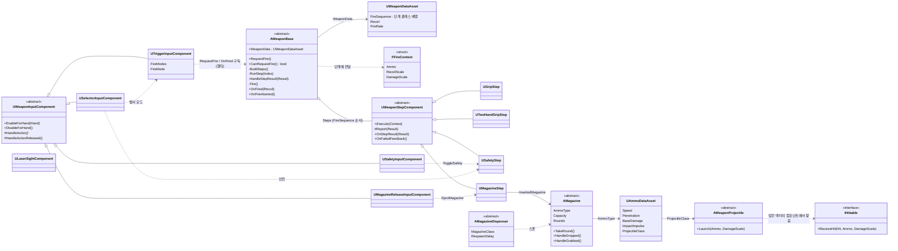
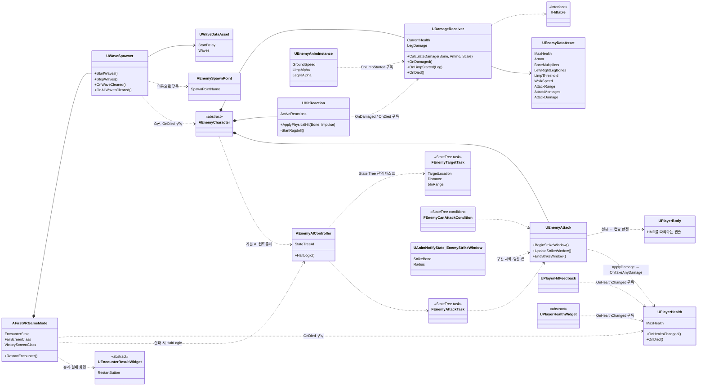
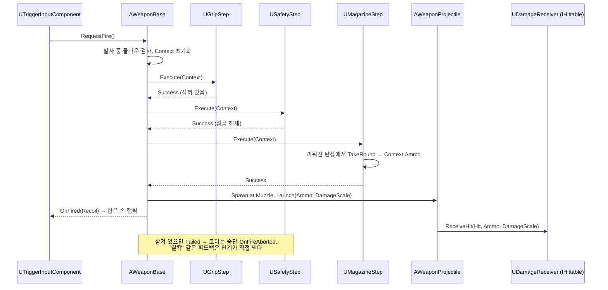

# FirstVR — 컴포넌트 조합형 VR 무기 시스템

Unreal Engine 5.7 · C++ · OpenXR

VR 슈팅 기술 시연 프로젝트입니다. 핵심은 **무기를 상속 계층이 아니라 컴포넌트 조합과 데이터로 만드는 구조**입니다.
권총·단발 소총·연발 소총은 같은 C++ 부품을 서로 다르게 붙이고, 발사 순서는 데이터 에셋에 적습니다.
여기에 부위별 피해와 부분 물리 피격 반응을 하는 적, State Tree로 판단하는 적 AI, 웨이브 전투 구간을 붙여
"집는다 → 쏜다 → 맞는다 → 반응한다 → 막아 낸다"의 한 사이클을 완성했습니다.

> 헤드셋 없이 Meta XR Simulator(OpenXR 런타임)로 개발했습니다. 실기기 검증은 아직입니다.

---

## 목차

1. [무엇을 보여 주는가](#1-무엇을-보여-주는가)
2. [실행 방법](#2-실행-방법)
3. [폴더 구조](#3-폴더-구조)
4. [클래스 관계도](#4-클래스-관계도)
5. [핵심 알고리즘](#5-핵심-알고리즘)
6. [사용한 패턴과 적용 이유](#6-사용한-패턴과-적용-이유)
7. [확장성 증명: C++ 없이 소총 조립](#7-확장성-증명-c-없이-소총-조립)
8. [디버깅 도구](#8-디버깅-도구)
9. [에셋과 라이선스](#9-에셋과-라이선스)

---

## 1. 무엇을 보여 주는가

| 영역 | 내용 |
|---|---|
| 무기 | 발사 = 단계 컴포넌트를 데이터 순서대로 통과하는 파이프라인. 단계는 `Success`/`Failed`/`Pending`을 발행하고 코어는 구체 단계를 모른다 |
| VR 조작 | 템플릿 잡기 재사용, 잡은 손별 입력 매핑, 두 손 조준, 보조 손 이어받기, 조정간(안전·단발·연발), 탄창 빼기·끼우기 |
| 탄창 | 탄의 원본은 집는 탄창 액터. 무기 근처에서 놓으면 결합, 버튼으로 빼면 물리로 떨어지고 일정 시간 뒤 사라짐. 보급대가 다시 채움 |
| 적 | 본별 피해 배율·관통 대비 방어, 맞은 본 아래만 물리 시뮬레이션 후 애니메이션으로 블렌드 복귀, 다리 피해 누적 시 절뚝임(절차적 IK), 사망 래그돌 |
| 적 AI | State Tree. C++ 전역 태스크가 HMD 아래 바닥을 목표로 거리·사거리 판정, 공격은 몽타주 + Anim Notify State 구간 판정 |
| 전투 구간 | 플레이어 체력(언리얼 기본 데미지 경로), 피격 비네트·햅틱·사운드, 손목 체력 위젯, 웨이브 데이터, 승리·실패 3D 화면과 다시 시작 |

---

## 2. 실행 방법

- **엔진**: Unreal Engine 5.7, Visual Studio 2022(C++ 게임 개발 워크로드) 또는 JetBrains Rider
- **플러그인**: `OpenXR`, `StateTree`, `GameplayStateTree` (`.uproject`에 켜져 있음)
- **열기**: `FirstVR.uproject` → 모듈 빌드 묻는 창에서 빌드, 또는 IDE에서 `FirstVREditor Win64 Development` 빌드 후 열기
- **레벨**
  - `Content/Portfolio/Maps/L_Combat` — 전투 구간 (무기 테이블, 탄창 보급대, 세 입구에서 웨이브)
  - `Content/Portfolio/Maps/L_WeaponTest` — 무기·적 실험장
  - `Content/Portfolio/Maps/L_WeaponTest_Etc` — 탄창 교체 시험 (웨이브 없음)
- **VR 실행**: 플레이 버튼 옆 `⋮` → `VR Preview`. 헤드셋이 없으면 Meta XR Simulator를 OpenXR 런타임으로 지정한다

| 조작 (Quest 컨트롤러) | 동작 |
|---|---|
| 그립 | 잡기 / 놓기 (무기, 보조 손잡이, 탄창) |
| 트리거 | 발사 (연발 모드면 누르는 동안 반복) |
| A / X | 안전장치 토글, 연발 소총은 조정간 (안전 → 단발 → 연발) |
| B / Y | 탄창 빼기 |
| 탄창을 무기 탄창 결합부 근처에서 놓기 | 탄창 끼우기 |

---

## 3. 폴더 구조

```
Source/FirstVR/
├── Public|Private/Weapon/      무기 코어, 데이터, 투사체, 탄창, 입력 컴포넌트
│   └── Steps/                  발사 단계 컴포넌트 (파지, 두 손, 안전장치, 탄창)
├── Public|Private/Enemy/       피해 수신, 피격 반응, 공격, 애님 인스턴스, Anim Notify
│   └── AI/                     AI 컨트롤러, State Tree 태스크·조건
├── Public|Private/Player/      플레이어 체력, 피격 피드백, 몸 캡슐
├── Public|Private/Game/        게임 모드, 웨이브 데이터·진행, 스폰 지점
└── Public|Private/UI/          손목 체력 위젯, 결과 화면 위젯

Content/Portfolio/              직접 만든 에셋만 (BP 자식, 데이터 에셋, 레벨, 입력, UI)
Docs/
├── PLAN.md                     설계 문서 (결정과 그 이유)
└── WEAPON_ASSEMBLY.md          빈 무기에서 소총을 조립하는 과정 (스크린샷 포함)
```

C++ 클래스는 모두 추상(`Abstract`)이거나 BP 자식에서 쓰는 부모입니다. 메시·사운드·입력 에셋 같은 "모양"은 BP 자식과 데이터 에셋에서 정하고, 규칙은 C++에 둡니다.

---

## 4. 클래스 관계도

### 4.1 무기



- **코어(`AWeaponBase`)가 아는 것은 추상 단계 `UWeaponStepComponent`와 `FFireContext`뿐입니다.** `#include "MagazineStep.h"` 같은 줄이 코어에 없습니다.
- 입력 컴포넌트와 레이저 사이트는 발사 단계가 아닌 **부품**입니다. 같은 액터의 다른 컴포넌트를 찾아 호출합니다.

### 4.2 적 · 전투 구간 · 플레이어



- **무기 시스템과 적 시스템은 `IHittable` 한 곳에서만 만납니다.** 투사체는 탄 데이터와 `DamageScale`만 넘기고 피해 계산은 `UDamageReceiver`가 합니다.
- **의존 방향은 한쪽입니다.** 게임 모드는 적·플레이어를 알지만, 적과 플레이어 컴포넌트는 게임 모드를 모릅니다(이벤트만 발행).

### 4.3 발사 한 번의 흐름



---

## 5. 핵심 알고리즘

### 5.1 단계 파이프라인 (`AWeaponBase`)

```text
BeginPlay:  FireSequence의 클래스마다 FindComponentByClass → Steps 배열
            하나라도 없으면 Steps를 비워 발사 불가 (조립 실수를 시작 시점에 드러냄)

RequestFire: 이미 진행 중 / 단계 없음 / 쿨다운(1 / FireRate) → 무시
             Context 초기화 → RunStep(0)

RunStep(i):  현재 단계의 OnStepResult만 구독 → Execute(Context)

HandleStepResult:
  Pending → 그대로 기다림 (단계가 나중에 다시 Report)
  Failed  → 구독 해제, 중단, OnFireAborted
  Success → 구독 해제, 다음 단계 또는 마지막이면 Fire()
```

- 결과를 **반환값이 아니라 델리게이트**로 받기 때문에, 타이머나 애니메이션을 기다리는 비동기 단계(`Pending`)도 같은 규칙으로 끼울 수 있습니다(검증용 `UDebugPendingStep`).
- 실패 피드백은 부모의 비가상 `Report(Failed)`가 `OnFailedFeedback`(BP 이벤트)을 자동으로 부릅니다. 자식은 판정만 하고, 피드백 모양은 BP에서 정합니다.
- 쿨다운은 요청 시각이 아니라 **실제 발사 시각** 기준이라, 대기 단계가 있어도 발사 간격이 `FireRate`를 넘지 않습니다.

### 5.2 두 손 조준 (`UTwoHandGripStep`)

주 손이 무기를 잡고 있는 상태에서 보조 손잡이를 잡으면, 무기가 주 손잡이를 축으로 보조 손을 향해 돌아갑니다.

```text
조준 시작 시 저장: 무기 루트의 부모(주 손)에 대한 상대 트랜스폼 AimBaseRelative,
                   액터 기준 주 손잡이 위치 GripLocal, 보조 손잡이 위치 SupportLocal

매 틱 (두 손일 때만 켬, TG_PostPhysics):
  BaseWorld  = AimBaseRelative × 주 손 월드 트랜스폼        // 한 손으로 들었을 때의 자세
  GripWorld  = BaseWorld(GripLocal)
  CurrentDir = BaseWorld(SupportLocal) − GripWorld           // 지금 보조 손잡이 방향
  TargetDir  = 보조 손 위치 − GripWorld                       // 보조 손 방향
  Δ          = FindBetweenNormals(CurrentDir, TargetDir)      // 최소 회전
  액터 위치  = GripWorld + Δ(BaseWorld.위치 − GripWorld)       // 주 손잡이 기준으로 회전
  액터 회전  = Δ × BaseWorld.회전
```

- 매 틱 **저장해 둔 한 손 자세에서 다시 계산**하므로 오차가 누적되지 않고, 보조 손을 놓으면 한 손 자세로 정확히 돌아옵니다.
- 손잡이를 축으로 돌리기 때문에 주 손과 무기의 결합 위치가 어긋나지 않습니다.
- 반동은 같은 단계가 `Context.RecoilScale`에 한 손 1.0 / 두 손 0.4를 곱해 기록합니다. 두 손 파지는 발사 조건이 아니라 **배율 기록자**라 항상 `Success`입니다.

### 5.3 탄창 결합 탐색 (`AMagazine::HandleDropped`)

```text
놓음 이벤트 → 다음 틱에 처리 (템플릿 잡기가 떼기·물리 켜기를 끝낸 뒤)
  모든 UMagazineStep 중
    같은 월드 · BeginPlay 끝남 · 비어 있음 · AllowedMagazines에 이 탄창 클래스가 있음
    → 탄창 윗면(MagazineTop) ↔ MagazineWell 거리가 가장 가까운 것
  가장 가까운 거리 ≤ InsertRadius → InsertMagazine (물리·충돌 끄고 Well에 스냅)
  아니면 물리로 떨어짐 (가장 가까운 거리를 로그로 남김)
```

- 물리 루트(박스 충돌체)는 원점을 옮길 수 없어서, **이름 있는 기준점**(`MagazineTop`, `MagazineWell`)끼리 맞춥니다. 스냅 후 `MagazineTop` 상대 트랜스폼의 역만큼 몸통을 옮깁니다.
- 빼낼 때는 무기 몸체 안에서 물리가 켜져 튕겨 나가지 않도록 `EjectClearTime` 동안 `PhysicsBody` 채널만 무시하고, 버린 탄창은 `DiscardLifeSpan` 뒤 사라집니다(그 전에 잡으면 취소).
- 보급대는 놓아 둔 탄창이 손이나 무기에 붙었는지, 끼워졌는지, 멀어졌는지, 사라졌는지를 **0.25초 타이머**로 봅니다. 탄창 이벤트를 구독하지 않아서 탄창 BP를 건드리지 않습니다.

### 5.4 피해 계산 (`UDamageReceiver::CalculateDamage`)

```text
ArmorFactor = Armor > 0 ? min(1, Penetration / Armor) : 1
Damage      = BaseDamage × BoneMultiplier(맞은 본, 없으면 1.0) × DamageScale × ArmorFactor
```

- 무기 공통값은 무기 데이터, 탄을 따라가는 값(`BaseDamage`, `Penetration`)은 탄 데이터, 맞은 부위를 따라가는 값(`BoneMultipliers`, `Armor`)은 적 데이터에 둡니다. 새 탄이나 새 적은 데이터 에셋만 추가하면 됩니다.
- 다리 본(`Left/RightLegBones`) 피해를 누적해 `LimpThreshold`를 넘으면 그 탄이 맞은 쪽 다리로 절뚝임을 시작합니다.

### 5.5 부분 물리 피격 반응 (`UHitReaction`)

```text
맞음:  충격량 = 탄 ImpactImpulse × (최종 피해 / BaseDamage), 방향 = 탄 진행 방향
       이미 반응 중인 본의 자식을 맞았으면 → 그 반응의 뿌리 본에서 다시 시작 (흡수)
       새 뿌리가 기존 반응들의 부모면     → 자식 반응들을 지우고 합침
       뿌리 아래만 SimulatePhysics + PhysicalAnimation 모터(월드 기준), 블렌드 가중치 1
       맞은 본에 AddImpulse(속도 변화)

틱 (반응이 있을 때만):
       반응마다 경과 시간 → 가중치 = 1 − 경과 / RecoverTime
       0이 되면 그 뿌리 아래 물리 끄기, 반응이 없으면 틱 끄기

사망:  반응 비우고 모터 세기 0, 전신 물리 (래그돌), 이후 피격 무시
```

- 몸 전체가 아니라 **맞은 본 아래만** 물리로 돌리고, 모터가 애니메이션 자세로 당긴 뒤 가중치를 0으로 내려 자연스럽게 돌아옵니다.
- 골반(루트 바디)을 맞아도 몸이 돌아간 채 남지 않도록 메시의 `PhysicsTransformUpdateMode`를 `ComponentTransformIsKinematic`으로 둡니다.
- 메시 물리를 만지는 컴포넌트는 이것 하나뿐입니다(피격·사망 모두). 물리 상태가 여러 곳에서 엇갈리지 않게 하기 위해서입니다.

### 5.6 절뚝임 자세 (`UEnemyAnimInstance`)

- 상태 머신 대신 `LimpAlpha` 블렌드 하나로 골반을 내리고 다친 쪽 발 IK 목표를 올린 뒤 `Leg IK`로 다리를 맞춥니다(절차적 보정).
- `LegIKAlpha = LimpAlpha × (1 − 공격 몽타주 가중치)`. 공격 중에는 IK를 꺼서 발차기 발이 바닥에 묶이지 않습니다.

### 5.7 적 타격 판정: 지나간 선분 ↔ 몸 캡슐 (`UEnemyAttack`)

```text
Anim Notify State "Enemy Strike Window" (StrikeBone, Radius)
  Begin:  지난 위치 = 본의 현재 위치, 맞음 = false
  Tick:   선분(지난 위치 → 현재 위치)과 플레이어 몸 캡슐 표면 사이 최단 거리
          거리 ≤ Radius → ApplyDamage 한 번, 이 구간에서는 더 판정 안 함
          지난 위치 = 현재 위치
  End:    못 맞혔으면 가장 가까웠던 거리와 샘플 수를 로그로 남김
```

- 한 프레임의 점 판정은 빠른 휘두르기가 프레임 사이에 몸을 **건너뛰어** 빗나갔습니다. 본이 지나간 선분으로 판정해 프레임 속도와 상관없이 맞습니다.
- 플레이어 몸은 HMD를 따라가는 캡슐(`UPlayerBody`)입니다. 템플릿 VR 폰에는 충돌체가 없어 적이 플레이어를 통과했기 때문에 추가했습니다.
- 피해는 언리얼 기본 경로(`ApplyDamage` → `OnTakeAnyDamage`)로 보냅니다. 플레이어 쪽은 이 경로만 알면 됩니다.

### 5.8 추적과 사거리 히스테리시스 (`FEnemyTargetTask`)

```text
목표 = HMD 위치의 X, Y + 폰 원점(플레이 공간 바닥)의 Z
거리 = 적과 목표의 수평 거리
들어올 때:  거리 ≤ AttackRange + 10            (Move To가 몇 cm 바깥에서 멈추는 것을 허용)
나갈 때:    거리 > AttackRange + RangeHysteresis(50)
```

- VR 폰의 위치는 플레이어가 아니라 **트래킹 원점**이라, 실제 플레이어 위치(HMD)의 바닥을 목표로 씁니다.
- 경계에서 추적·대기가 매 틱 뒤집히지 않도록 들어오는 기준과 나가는 기준을 다르게 둡니다.
- State Tree 에셋은 엔진 기본 `Move To`에 이 태스크의 출력을 바인딩만 합니다. 판단 데이터는 C++, 흐름은 에셋입니다.

### 5.9 웨이브 진행 (`UWaveSpawner`)

```text
StartWaves: StartDelay 뒤 웨이브 0
웨이브 시작: 묶음마다 반복 타이머 (묶음 StartDelay 뒤 시작, SpawnInterval 간격, 0이면 한꺼번에)
스폰:        SpawnPointName으로 AEnemySpawnPoint를 찾아 캡슐 반 높이만큼 올려 스폰, OnDied 구독
             스폰 실패도 남은 수에서 뺀다 (웨이브가 영원히 안 끝나는 것 방지)
적 사망:     생존 수 감소 → 모두 나왔고 0명이면 OnWaveCleared → RestAfterClear 뒤 다음
             마지막이면 OnAllWavesCleared → 게임 모드가 Victory
실패:        게임 모드가 StopWaves (남은 타이머 모두 취소) + 레벨의 적 HaltLogic
```

- 데이터 에셋은 레벨의 액터를 직접 가리킬 수 없어서 스폰 지점을 **이름**으로 고릅니다. 같은 웨이브 데이터를 다른 레벨에서도 쓸 수 있습니다.

---

## 6. 사용한 패턴과 적용 이유

| 패턴 | 적용한 곳 | 이유 |
|---|---|---|
| **컴포넌트 조합** (상속 대신 조합) | 무기 = `AWeaponBase` + 단계·입력·부품 컴포넌트 | 무기 종류마다 상속 계층을 만들면 "두 손 + 안전장치 + 연발" 같은 조합마다 클래스가 늘어난다. 부품을 붙였다 떼는 방식이면 새 무기가 새 C++ 없이 나온다 |
| **파이프라인 / 책임 연쇄** | 발사 = `FireSequence` 순서의 단계 통과 | 발사 조건(잡힘, 안전, 탄)을 하나씩 독립된 단계로 분리. 단계는 다음 단계를 모르고 순서는 데이터에만 있어서, 순서 변경·단계 추가가 데이터 편집으로 끝난다 |
| **데이터 주도** (`UPrimaryDataAsset`) | 무기·탄·적·웨이브 데이터 | 값은 그 값이 따라가는 대상에 둔다(무기 공통 / 탄 / 맞은 부위). 밸런스 변경이 코드와 빌드에서 분리된다 |
| **옵저버** (멀티캐스트 델리게이트) | `OnStepResult`, `OnFired`, `OnDamaged`, `OnLimpStarted`, `OnDied`, `OnHealthChanged`, `OnWaveCleared` | 발행하는 쪽은 누가 반응하는지 모른다. 피격 반응·애니메이션·UI·게임 규칙이 서로 몰라도 같은 사건에 반응한다. 의존 방향이 한쪽으로 유지된다 |
| **인터페이스** | `IHittable` | 무기 시스템과 적 시스템의 유일한 접점. 투사체는 맞은 대상이 무엇인지 몰라도 되고, 부서지는 물체 같은 새 대상도 인터페이스만 구현하면 된다 |
| **템플릿 메서드** | `UWeaponStepComponent::Report`(비가상) → `OnFailedFeedback`, `UWeaponInputComponent::HandleAction` | 공통 흐름(결과 발행, 손별 입력 매핑 켜고 끄기)은 부모가 고정하고 자식은 판단 하나만 재정의한다. 실수로 피드백을 빼먹거나 입력 해제를 빠뜨릴 수 없다 |
| **C++ 규칙 + BP 모양** | 모든 C++ 클래스는 `Abstract`, BP 자식이 메시·사운드·입력 에셋 지정 | 규칙과 테스트 가능한 로직은 C++, 아트와 연출은 BP·에셋. 아트 교체(Fab 에셋)가 코드 변경 없이 된다 |
| **이름 기반 기준점** | `Muzzle`, `Grip`, `SupportGrip`, `MagazineWell`, `MagazineTop`, `SpawnPointName` | 메시 구조에 의존하지 않는다. 그레이박스 메시를 상용 에셋으로 바꿔도 같은 이름의 기준점만 두면 된다 |
| **상태 패턴 (State Tree)** | 적 AI: 추적 → 대기 → 공격 | 판단 흐름은 에셋에서 보이고 고칠 수 있게, 계산(목표·거리·공격 가능 여부)은 C++ 태스크·조건으로. 에디터에서 활성 상태를 디버깅할 수 있다 |
| **이벤트 구동 + 필요할 때만 틱** | 두 손 조준, 피격 반응, 연발, 피격 비네트 | 상태가 있는 동안만 틱을 켜고 끝나면 끈다. VR은 프레임 예산이 빠듯해서 쉬는 컴포넌트가 비용을 내지 않게 했다 |

---

## 7. 확장성 증명: C++ 없이 소총 조립

같은 C++ 부품을 다르게 붙여 세 무기를 만들었습니다.

| 무기 | 발사 순서 (`FireSequence`) | 입력·부품 |
|---|---|---|
| 권총 | 파지 → 탄창 | 트리거, 탄창 빼기, 레이저 |
| 단발 소총 | 파지 → 두 손 → 안전장치 → 탄창 | 트리거, 안전장치, 탄창 빼기, 레이저 |
| 연발 소총 | 파지 → 두 손 → 안전장치 → 탄창 | 트리거(단발·연발), **조정간**, 탄창 빼기, 레이저 |

빈 `AWeaponBase` 블루프린트에 부품을 하나씩 붙여 연발 소총까지 다시 조립하는 과정은 [Docs/WEAPON_ASSEMBLY.md](Docs/WEAPON_ASSEMBLY.md)에 단계별 로그와 스크린샷으로 정리했습니다.

---

## 8. 디버깅 도구

- **로그 카테고리**: `LogWeapon`, `LogEnemy`, `LogPlayer`, `LogEncounter`, `LogWave` — 단계 결과, 피해 계산, 상태 전환을 모두 로그로 남겨 VR 안에서 보이지 않는 판정을 출력 로그로 확인했습니다.
- **콘솔 명령** (Play 중 `~`)

| 명령 | 동작 |
|---|---|
| `Enemy.Limp [Left\|Right]` | 레벨의 적을 절뚝이게 |
| `Enemy.Kill` | 레벨의 적 사망 |
| `Player.Damage [Amount]` | 플레이어에게 피해 |
| `Encounter.Restart` | 현재 레벨 다시 열기 |

- `UEnemyAttack`의 `bDrawStrikeDebug`를 켜면 타격 판정 선분·반경·몸 캡슐을 그립니다.

---

## 9. 에셋과 라이선스

- `Content/Portfolio/`의 에셋과 `Source/`의 코드는 이 프로젝트에서 직접 만들었습니다.
- 템플릿 콘텐츠(`XRFramework`, `VRTemplate`, `VRSpectator`, `LevelPrototyping`, `Weapons`, `Characters/Mannequins`, `XRMannequins`)는 Unreal Engine VR 템플릿과 Third Person 콘텐츠 팩에서 왔습니다.
- Fab(유료) 에셋 폴더는 라이선스상 재배포할 수 없어 저장소에서 제외했습니다(`.gitignore`).
- 바이너리 에셋은 Git LFS로 관리합니다. 클론할 때 `git lfs install`이 필요합니다.

설계 결정과 그 이유는 [Docs/PLAN.md](Docs/PLAN.md)에 시간순으로 남겨 두었습니다.
